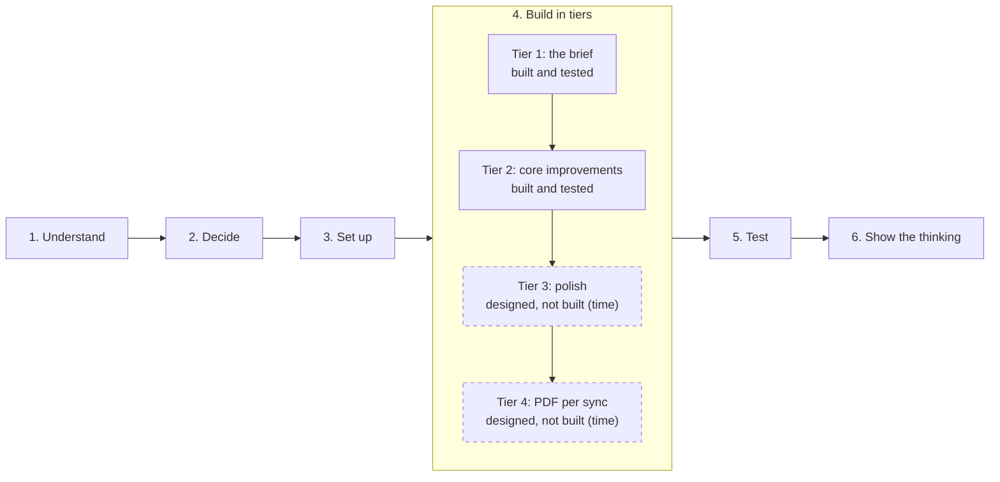

# MDM Device Sync

*A case study set by WorkWize during their hiring process for a Full Stack Developer role, shared publicly with their permission. Not a WorkWize product.*

A Laravel + React app that imports assigned laptops and their owners from Jamf (a mock API response) into MySQL, and shows them in a website.

- The assignment brief came from WorkWize. It is not included in this public copy; the decision records quote what each rule needed.
- Built by Muhammad Ghazwan as product owner, with claude.ai and Claude Code: [how it was built](docs/HOW-WE-BUILT-THIS.md)

## Start here (about 10 minutes)

1. **This page** (2 min): "How this was designed", "Three product calls" and the two diagrams.
2. [docs/DECISION-RECORDS.md](docs/DECISION-RECORDS.md) (3 min): the six product decisions with the options turned down, the reasons and the changes of mind; the laptop status diagram and the screens that prove each decision.
3. [docs/HOW-WE-BUILT-THIS.md](docs/HOW-WE-BUILT-THIS.md) (2 min): who did what, the build loop, the catches and the mistakes, on every side.
4. [docs/TEST-LOG.md](docs/TEST-LOG.md) (1 min): "In one minute" at the top.
5. [docs/WHAT-I-WOULD-DO-NEXT.md](docs/WHAT-I-WOULD-DO-NEXT.md) (2 min): what's designed but not built, and where the business value is.
6. For engineers: the [code tour](docs/ENGINEERING.md#code-tour-about-10-minutes), six files to open first.

## All the docs

| File | What it shows | Most useful for |
|---|---|---|
| [DECISION-RECORDS.md](docs/DECISION-RECORDS.md) | The six product decisions: options, choice, reasons, changes of mind, trade-offs, with diagrams and screenshots | Product and hiring managers |
| [HOW-WE-BUILT-THIS.md](docs/HOW-WE-BUILT-THIS.md) | Roles, the rules for using AI, the build loop, catches and mistakes by every side | Anyone checking how AI was used |
| [PRINCIPLES.md](docs/PRINCIPLES.md) | The 18 principles in Muhammad's words, traced to code and tests | Product and engineering |
| [DECISIONS.md](docs/DECISIONS.md) | Every rule in one line, with built or designed-not-built status | Engineers |
| [PRODUCT-NOTES.md](docs/PRODUCT-NOTES.md) | The delete puzzle, the leaver moment, messy Jamf data, business value | Product and business |
| [WHAT-I-WOULD-DO-NEXT.md](docs/WHAT-I-WOULD-DO-NEXT.md) | Designed but not built; business, product, scale, more tools | Product and engineering leads |
| [TEST-LOG.md](docs/TEST-LOG.md) | Every scenario, odd data, scale, crashes; the 16 findings with before and after | Engineers |
| [MISTAKES.md](docs/MISTAKES.md) | Eight mistakes and what they taught | Anyone |
| [IDEAS-AND-LIMITATIONS.md](docs/IDEAS-AND-LIMITATIONS.md) | Known limitations and the trade-offs that were accepted | Engineers and product |
| [ENGINEERING.md](docs/ENGINEERING.md) | Run the app and the tests, the code tour, the sync design and its improvements over the reference | Engineers |
| [CHANGELOG.md](docs/CHANGELOG.md) | Every save point, newest first | Engineers |

## How this was designed

- **Decisions first, code second.** Every product decision (what happens when someone leaves, when a laptop disappears from Jamf, when the Jamf list is broken, what the screens show) was made by Muhammad Ghazwan before any code was written. Muhammad is the product owner. He has only basic Python and SQL, and no PHP; his experience is in sales, product and AI systems.
- **18 principles behind the decisions**, in his own words: [docs/PRINCIPLES.md](docs/PRINCIPLES.md). The main one: *Jamf decides what's true; WorkWize decides how to show it and what to do about it* (P1). Decisions name their principles, and so does the code where a principle becomes a rule.
- **AI was used openly.** claude.ai helped think through the options and reviewed every plan; Claude Code wrote the code and the tests. Every plan was approved by Muhammad before it was built, and every save point (commit) names Claude as co-author.
- **Tested and corrected.** The test log ([docs/TEST-LOG.md](docs/TEST-LOG.md)) covers the agreed scenarios, odd data, 1,000 to 25,000 laptops and crashes. What testing found, what Muhammad decided and what was fixed are all in the log. Mistakes, by every side, are in [docs/MISTAKES.md](docs/MISTAKES.md).

## Three product calls

Short versions. Each one with its options, the reasons and the changes of mind: [docs/DECISION-RECORDS.md](docs/DECISION-RECORDS.md).

- **Someone leaves the company.** The brief says not to import laptops without an owner. We read that as applying to *new* laptops: a known laptop that loses its owner in Jamf is kept and marked **"To be collected from {last owner}"**, because that's exactly when IT needs to act. ([DECISIONS.md](docs/DECISIONS.md) row 1; [P3](docs/PRINCIPLES.md#p3-never-lose-data-silently-prefer-flagging-plus-a-human-in-the-loop-over-deleting), [P4](docs/PRINCIPLES.md#p4-the-data-must-stay-honest-what-the-website-shows-must-match-reality), [P5](docs/PRINCIPLES.md#p5-a-status-should-lead-to-action))
- **A laptop disappears from Jamf.** It could be retired, lost, stolen or a Jamf error. Flagging it "No longer in Jamf" is safe in all four cases; deleting it isn't. A sync never deletes anything. (Row 2; [P3](docs/PRINCIPLES.md#p3-never-lose-data-silently-prefer-flagging-plus-a-human-in-the-loop-over-deleting), [P14](docs/PRINCIPLES.md#p14-things-clear-themselves-when-theyre-done))
- **Jamf sends something odd.** One broken entry is skipped with a reason instead of blocking everyone, and a value WorkWize can't read is shown as Jamf sent it, never guessed and never hidden. (Rows 10 and 18; [P2](docs/PRINCIPLES.md#p2-design-for-the-everyday-customer-make-the-worst-case-safe-and-fixable-dont-complicate-the-everyday-experience-for-rare-cases), [P4](docs/PRINCIPLES.md#p4-the-data-must-stay-honest-what-the-website-shows-must-match-reality), [P16](docs/PRINCIPLES.md#p16-never-make-a-gap-look-like-our-mistake-and-never-say-something-thats-only-sometimes-true))

## What's built, and what's designed but not built

Tier 1 (the brief) and Tier 2 (core improvements) are built and tested. Tier 3 (polish) and Tier 4 (stretch) were planned and fully designed, but not built because of time. Each has its decision, Muhammad's reasoning and its principles written down in [docs/DECISIONS.md](docs/DECISIONS.md), so it can be built as designed.

*The order of the work. Tiers 1 and 2 are built and tested; Tiers 3 and 4 (dashed) are designed, not built, because of time.*

The seven features that are designed but not built, each with its decision and principles: [WHAT-I-WOULD-DO-NEXT.md](docs/WHAT-I-WOULD-DO-NEXT.md#designed-not-built). The status of every decision: [DECISIONS.md](docs/DECISIONS.md).

## What it looks like

*Screenshots were taken on 16 Oct 2026. The top bar has changed since: it now shows the app's name, "MDM Device Sync".*

**After a sync, what needs a person comes first**, by name and with a link: here a leaver's laptop to collect and a laptop that disappeared from Jamf.

**When Jamf sends something WorkWize can't use**, it says so and shows what Jamf sent, instead of guessing or hiding it.

**When something breaks, the message is true and says what to do.** Before and after, from testing:

| Before (shows the earlier behaviour and look) | After |
|---|---|
|  |  |
|  |  |

More pictures, next to each test case: [docs/TEST-LOG.md](docs/TEST-LOG.md).

## For engineers

How to start the app, run the tests and try a scenario, a six-file code tour, and how the sync service is designed: [docs/ENGINEERING.md](docs/ENGINEERING.md). In short: `docker compose up`, then open http://localhost:5173 and press **Sync Now**.

## Licence

All rights reserved: you may view this repository, but not copy or reuse it without permission. See [LICENSE](LICENSE). The case study was set by WorkWize, who allowed this public copy; the WorkWize name belongs to WorkWize.
