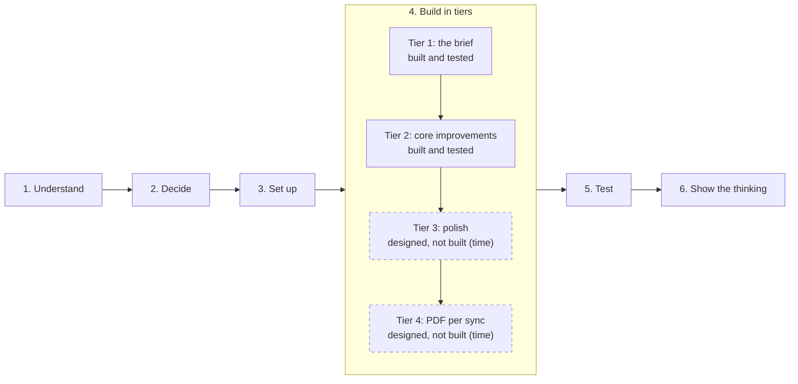
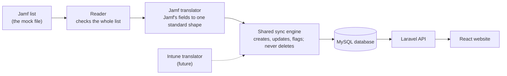

# WorkWize MDM Device Sync

A Laravel + React app that imports assigned laptops and their owners from Jamf (a mock API response) into MySQL, and shows them in a website.

- The assignment brief from WorkWize: [BRIEF.md](BRIEF.md)
- Built by Muhammad Ghazwan as product owner, with claude.ai and Claude Code: [how it was built](docs/HOW-WE-BUILT-THIS.md)

## For reviewers: start here (about 10 minutes)

1. **This page** (2 min): "How this was designed", "Three product calls" and the two diagrams.
2. [docs/DECISION-RECORDS.md](docs/DECISION-RECORDS.md) (3 min): the six product decisions with the options turned down, the reasons and the changes of mind; the laptop status diagram and the screens that prove each decision.
3. [docs/HOW-WE-BUILT-THIS.md](docs/HOW-WE-BUILT-THIS.md) (2 min): who did what, the build loop, the catches and the mistakes, on every side.
4. [docs/TEST-LOG.md](docs/TEST-LOG.md) (1 min): "In one minute" at the top.
5. [docs/WHAT-I-WOULD-DO-NEXT.md](docs/WHAT-I-WOULD-DO-NEXT.md) (2 min): what's designed but not built, and where the business value is.
6. For engineers: the [code tour](#code-tour-for-engineers-about-10-minutes), six files to open first.

## All the docs

| File | What it shows | Most useful for |
|---|---|---|
| [BRIEF.md](BRIEF.md) | WorkWize's assignment, unchanged | Everyone |
| [DECISION-RECORDS.md](docs/DECISION-RECORDS.md) | The six product decisions: options, choice, reasons, changes of mind, trade-offs, with diagrams and screenshots | Product and hiring reviewers |
| [HOW-WE-BUILT-THIS.md](docs/HOW-WE-BUILT-THIS.md) | Roles, the rules for using AI, the build loop, catches and mistakes by every side | Anyone checking how AI was used |
| [PRINCIPLES.md](docs/PRINCIPLES.md) | The 18 principles in Muhammad's words, traced to code and tests | Product and engineering |
| [DECISIONS.md](docs/DECISIONS.md) | Every rule in one line, with built or designed-not-built status | Engineers |
| [PRODUCT-NOTES.md](docs/PRODUCT-NOTES.md) | The delete puzzle, the leaver moment, messy Jamf data, business value | Product and business |
| [WHAT-I-WOULD-DO-NEXT.md](docs/WHAT-I-WOULD-DO-NEXT.md) | Designed but not built; business, product, scale, more tools | Product and engineering leads |
| [TEST-LOG.md](docs/TEST-LOG.md) | Every scenario, odd data, scale, crashes; the 16 findings with before and after | Engineers |
| [MISTAKES.md](docs/MISTAKES.md) | Eight mistakes and what they taught | Anyone |
| [IDEAS-AND-LIMITATIONS.md](docs/IDEAS-AND-LIMITATIONS.md) | Known limitations and the trade-offs that were accepted | Engineers and product |
| [CHANGELOG.md](docs/CHANGELOG.md) | Every save point, newest first | Engineers |

## How this was designed

- **Decisions first, code second.** Every product decision (what happens when someone leaves, when a laptop disappears from Jamf, when the Jamf list is broken, what the screens show) was made by Muhammad Ghazwan before any code was written. Muhammad is the product owner and doesn't have a coding background.
- **18 principles behind the decisions**, in his own words: [docs/PRINCIPLES.md](docs/PRINCIPLES.md). The main one: *Jamf decides what's true; WorkWize decides how to show it and what to do about it* (P1). Decisions name their principles, and so does the code where a principle becomes a rule.
- **AI was used openly.** claude.ai helped think through the options and reviewed every plan; Claude Code wrote the code and the tests. Every plan was approved by Muhammad before it was built, and every save point (commit) names Claude as co-author.
- **Tested and corrected.** The test log ([docs/TEST-LOG.md](docs/TEST-LOG.md)) covers the agreed scenarios, odd data, 1,000 to 25,000 laptops and crashes. What testing found, what Muhammad decided and what was fixed are all in the log. Mistakes, by every side, are in [docs/MISTAKES.md](docs/MISTAKES.md).

## Three product calls

Short versions. Each one with its options, the reasons and the changes of mind: [docs/DECISION-RECORDS.md](docs/DECISION-RECORDS.md).

- **Someone leaves the company.** The brief says not to import laptops without an owner. We read that as applying to *new* laptops: a known laptop that loses its owner in Jamf is kept and marked **"To be collected from {last owner}"**, because that's exactly when IT needs to act. ([DECISIONS.md](docs/DECISIONS.md) row 1; [P3](docs/PRINCIPLES.md#p3-never-lose-data-silently-prefer-flagging-plus-a-human-in-the-loop-over-deleting), [P4](docs/PRINCIPLES.md#p4-the-data-must-stay-honest-what-the-website-shows-must-match-reality), [P5](docs/PRINCIPLES.md#p5-a-status-should-lead-to-action))
- **A laptop disappears from Jamf.** It could be retired, lost, stolen or a Jamf error. Flagging it "No longer in Jamf" is safe in all four cases; deleting it isn't. A sync never deletes anything. (Row 2; [P3](docs/PRINCIPLES.md#p3-never-lose-data-silently-prefer-flagging-plus-a-human-in-the-loop-over-deleting), [P14](docs/PRINCIPLES.md#p14-things-clear-themselves-when-theyre-done))
- **Jamf sends something odd.** One broken entry is skipped with a reason instead of blocking everyone, and a value WorkWize can't read is shown as Jamf sent it, never guessed and never hidden. (Rows 10 and 18; [P2](docs/PRINCIPLES.md#p2-design-for-the-everyday-customer-make-the-worst-case-safe-and-fixable-dont-complicate-the-everyday-experience-for-rare-cases), [P4](docs/PRINCIPLES.md#p4-the-data-must-stay-honest-what-the-website-shows-must-match-reality), [P16](docs/PRINCIPLES.md#p16-never-make-a-gap-look-like-our-mistake-and-never-say-something-thats-only-sometimes-true))

## What's built, and what's designed but not built

Tier 1 (the brief) and Tier 2 (core improvements) are built and tested. Tier 3 (polish) and Tier 4 (stretch) were planned and fully designed, but not built because of time. Each has its decision, Muhammad's reasoning and its principles written down in [docs/DECISIONS.md](docs/DECISIONS.md), so it can be built as designed.



*The order of the work. Tiers 1 and 2 are built and tested; Tiers 3 and 4 (dashed) are designed, not built, because of time.*

The seven features that are designed but not built, each with its decision and principles: [WHAT-I-WOULD-DO-NEXT.md](docs/WHAT-I-WOULD-DO-NEXT.md#designed-not-built). The status of every decision: [DECISIONS.md](docs/DECISIONS.md).

## What it looks like

**After a sync, what needs a person comes first**, by name and with a link: here a leaver's laptop to collect and a laptop that disappeared from Jamf.


**When Jamf sends something WorkWize can't use**, it says so and shows what Jamf sent, instead of guessing or hiding it.


**When something breaks, the message is true and says what to do.** Before and after, from testing:

| Before (shows the earlier behaviour and look) | After |
|---|---|
|  |  |
|  |  |

More pictures, next to each test case: [docs/TEST-LOG.md](docs/TEST-LOG.md).

## Start the app

You only need [Docker Desktop](https://www.docker.com/products/docker-desktop/).

```bash
docker compose up
```

The first start takes a few minutes (Docker downloads MySQL, PHP and Node and installs the libraries). After that it starts in under a minute.

When it's ready, open:

| What | Address |
|---|---|
| Website | http://localhost:5173 |
| Backend health check | http://localhost:8000/api/health |

Press **Sync Now** on the website to import the laptops from the Jamf mock file.

## Stop or reset

```bash
docker compose down        # stop
docker compose down -v     # stop and delete the database (fresh start next time)
```

## Run the tests

With the app running:

```bash
docker compose exec backend php artisan test   # backend
docker compose exec frontend npm test          # website
```

What the tests cover, and how we check that they can fail: [docs/TEST-LOG.md](docs/TEST-LOG.md).

## Try a scenario

To see "To be collected", "No longer in Jamf", an empty list or a failed sync without editing WorkWize's mock file, start the backend with a scenario file, press Sync Now, then go back to normal. The scenarios are described in [backend/tests/Fixtures/jamf/README.md](backend/tests/Fixtures/jamf/README.md).

```bash
MDM_JAMF_MOCK_PATH=/var/www/backend/tests/Fixtures/jamf/emma-leaves.json docker compose up -d backend
docker compose up -d backend   # back to the real mock file
```

## Code tour (for engineers, about 10 minutes)

The six places to open first, in this order:

| # | File | What to look for |
|---|---|---|
| 1 | [`backend/app/Mdm/Jamf/JamfDeviceMapper.php`](backend/app/Mdm/Jamf/JamfDeviceMapper.php) | The Jamf translator, the only code that knows Jamf's field names. A broken entry becomes a skip with a reason; a value it can't read is kept as sent, never guessed |
| 2 | [`backend/app/Mdm/MdmSyncService.php`](backend/app/Mdm/MdmSyncService.php), `run()` | The sync engine in three steps: read the whole list (nothing changes if it can't be read), translate, then save everything in one transaction. `apply()` sets "To be collected"; `flagMissing()` flags laptops missing from the list and never deletes |
| 3 | [`backend/app/Mdm/MdmSyncService.php`](backend/app/Mdm/MdmSyncService.php), `sync()` | The lock: one sync at a time, a refused attempt is recorded, and after a crash `refusalMessage()` says "interrupted" instead of "already running" |
| 4 | [`backend/app/Actions/DeleteEmployee.php`](backend/app/Actions/DeleteEmployee.php) | Deleting a person: their laptops are kept and marked "Owner removed in WorkWize", never "To be collected" |
| 5 | [`frontend/src/lib/labels.js`](frontend/src/lib/labels.js) | What each status says on screen, with the last owner's name |
| 6 | [`backend/tests/Feature/Mdm/SyncEngineTest.php`](backend/tests/Feature/Mdm/SyncEngineTest.php), `test_t8_laptop_missing_from_the_list_is_flagged_not_deleted` | One test and its deliberate break: switching the flagging off, or deleting flagged laptops, makes it fail. Every rule was checked this way ([TEST-LOG.md](docs/TEST-LOG.md#how-we-check-that-a-test-can-fail)) |

## Where the improved sync service lives

The brief asks for an improved version of the reference `RefJamfSyncService` ([files/RefJamfSyncService.php](files/RefJamfSyncService.php)). Instead of one class that both reads Jamf's data and saves it, the sync is split into three parts:



*How a sync flows. Each MDM tool gets its own small translator; the engine, the database and the website are shared.*

| Part | File | What it does |
|---|---|---|
| Reader | [JamfProvider.php](backend/app/Mdm/Jamf/JamfProvider.php) | Reads the Jamf mock file and checks the whole list before handing anything over |
| Translator | [`backend/app/Mdm/Jamf/JamfDeviceMapper.php`](backend/app/Mdm/Jamf/JamfDeviceMapper.php) | The only place that knows Jamf's field names. Turns one Jamf laptop into a standard shape, or skips it with a reason |
| Shared sync engine | [`backend/app/Mdm/MdmSyncService.php`](backend/app/Mdm/MdmSyncService.php) | All the saving logic, for any MDM tool: creates, updates, follows reassignments, all in one transaction |

Why it's split: adding another MDM tool (Intune, Kandji) means writing one reader and one translator. The engine, the database and the website stay the same. A test proves this with a made-up second tool.

### Improvements over the reference

| # | Reference weakness | What we did | Status | Proved by |
|---|---|---|---|---|
| R1 | Reading Jamf and saving were mixed in one class | Reader, translator and shared engine | Fixed | [SyncEngineTest](backend/tests/Feature/Mdm/SyncEngineTest.php): engine works for another provider |
| R2 | A laptop that lost its owner in Jamf kept its old owner | Marked "To be collected from {last owner}", owner link removed | Fixed | SyncEngineTest t5 |
| R3 | Laptops missing from Jamf stayed forever | Flagged "No longer in Jamf · last seen with {last owner}", never deleted; the flag clears if the laptop comes back | Fixed | SyncEngineTest t8, t9, t15, t16 |
| R4 | A phone number removed in Jamf was kept | Removed values are removed here too | Fixed | SyncEngineTest t17 |
| R5 | A new person without a name could crash the save | Name falls back to the email; laptop name to the model | Fixed | SyncEngineTest t18, t19 |
| R6 | Storage always empty; most specs thrown away | Every Jamf field is kept (storage isn't in the mock) | Fixed | [JamfDeviceMapperTest](backend/tests/Unit/Mdm/JamfDeviceMapperTest.php): Alex's MacBook Pro field by field |
| R7 | "Updated" counted laptops that didn't change; no people counts | Only real changes count; people counted too | Fixed | SyncEngineTest t2, t3 |
| R8 | Two syncs at once could collide | Only one sync runs at a time; a second one is refused with "A sync is already running" and recorded | Fixed | [SyncLockTest](backend/tests/Feature/Mdm/SyncLockTest.php) t25 |
| R9 | No tidying of serials and emails; the same serial processed twice | Tidied; conflicting duplicates change nothing and are reported | Fixed | SyncEngineTest t23, t24 |
| R10 | Odd fallback that used the username as an email | Removed; an invalid email skips that entry | Fixed | SyncEngineTest t22 |
| R11 | No record of when syncs happened | Every attempt is stored: when, result, counts, skips, and the reason if it failed | Fixed | [SyncHistoryTest](backend/tests/Feature/Mdm/SyncHistoryTest.php) |
| R12 | No pagination | The completeness check already works across pages; paging itself isn't needed for the one-page mock | Partly | [JamfProviderTest](backend/tests/Feature/Mdm/JamfProviderTest.php): count mismatch stops the sync |
| R13 | Unclear what happens when something breaks halfway | The whole list is checked first; everything is saved in one transaction; one bad entry is skipped with a reason | Fixed | SyncEngineTest t14, t21, crash halfway saves nothing |
| R14 | One database query per laptop | Measured: about 3 queries per laptop; 5,000 laptops sync in about 3 seconds, 12,000 in about 7. Listed as a limitation | Not yet | [TEST-LOG.md](docs/TEST-LOG.md), "Scale" |

Tiers are explained at the top of [docs/DECISIONS.md](docs/DECISIONS.md); what's designed but not built is listed in [docs/WHAT-I-WOULD-DO-NEXT.md](docs/WHAT-I-WOULD-DO-NEXT.md#designed-not-built).

## Project layout

| Folder | What's in it |
|---|---|
| `backend/` | Laravel API (PHP 8.4, Laravel 13.35) |
| `frontend/` | React website (React 19, Vite) |
| `files/` | WorkWize's original files: the Jamf mock response, the reference sync code, the wireframe |
| `docs/` | The documents listed in "All the docs" above, and their screenshots in `docs/screenshots/` |

## Notes

- Local development setup only. The passwords in `docker-compose.yml` are local-only values, and the website and backend are only reachable from this computer.
- Debug mode is on (`APP_DEBUG=true` in `backend/.env.example`), which suits local development; it should be off anywhere else.
- WorkWize's template link returned a 404, so this repo was created fresh and the template's files were copied in unchanged.
