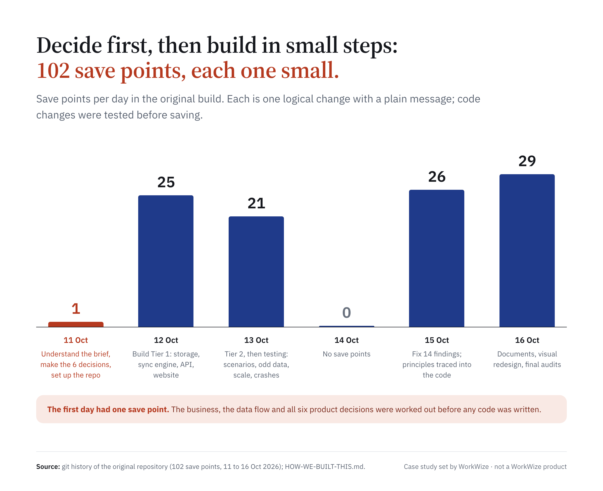
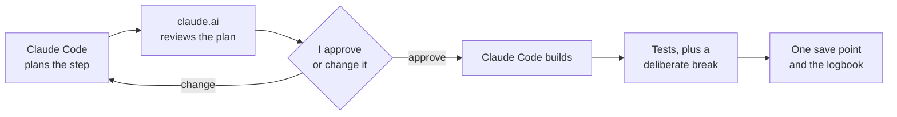
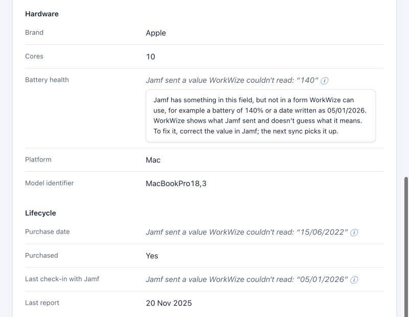
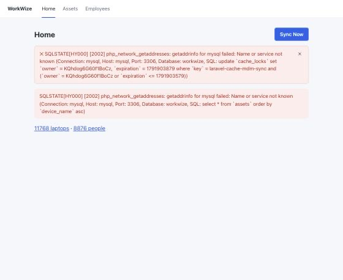
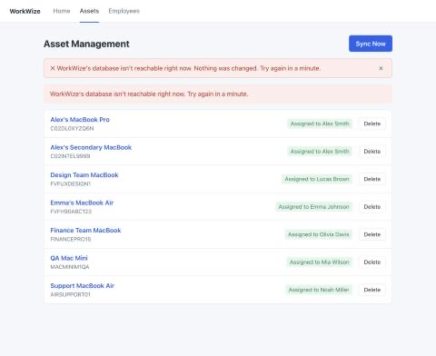
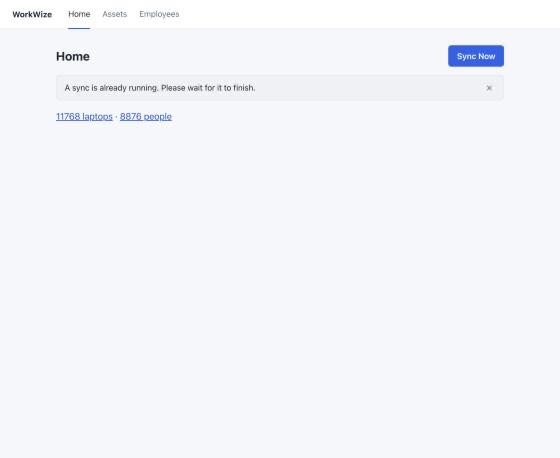
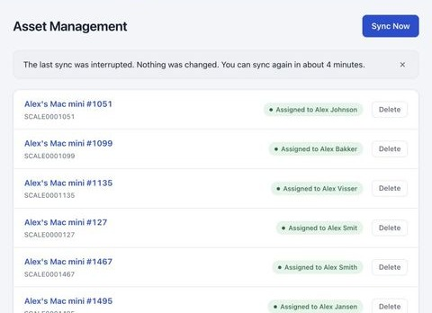
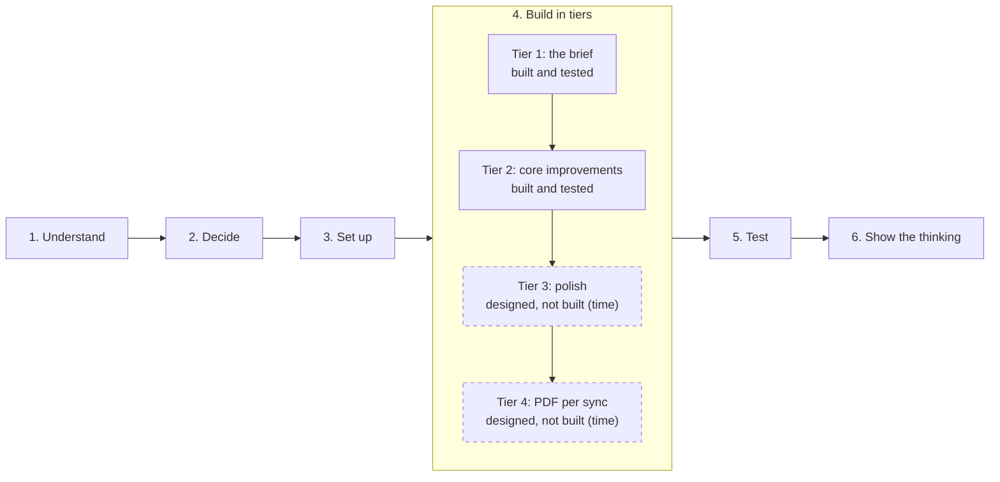
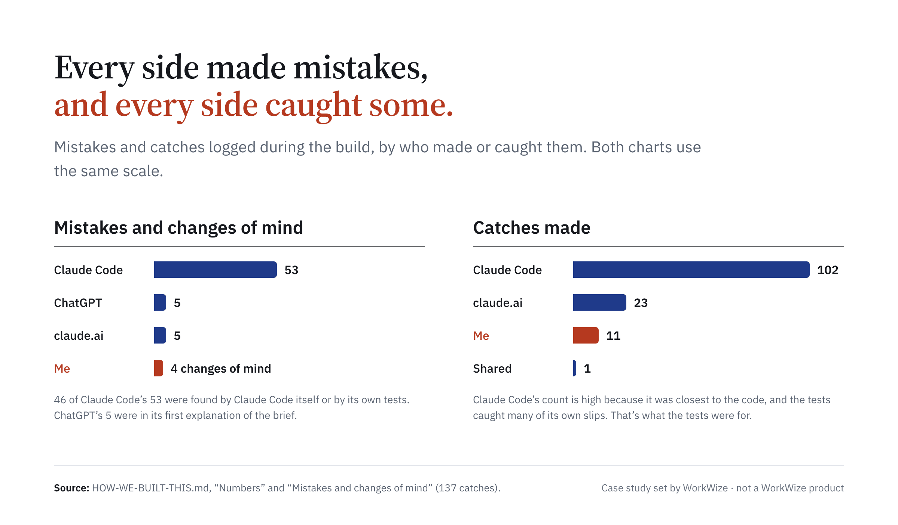

# MDM Device Sync

*A case study set by WorkWize during their hiring process for a Full Stack Developer role, shared publicly with their permission. Not a WorkWize product.*

![Summary. Laptops leave with people; the records should say so. Situation: WorkWize helps companies buy, ship, track and collect back laptops, and customers run Jamf. Complication: by the next sync people have left and laptops have vanished. Question: how should a sync treat change? Answer: never delete on a sync, flag what needs a person by name, change nothing when the list can't be read in full. Why I believe this: 6 decisions before any code; 250 tests and 82 deliberate breaks; 16 problems found, 14 fixed.](docs/images/summary.png)

**Keeping a company's laptop records true when the system that manages the laptops changes underneath them.**

Companies track their work laptops in a device-management tool such as Jamf. This product copies those laptops and their owners into an asset system, every time someone presses Sync, and decides what to do when the data changes: someone leaves, a laptop disappears, the list arrives broken.

**My role: product owner.** I framed the problem, made every product decision and wrote down why, set the rules for how AI built it, and approved every step before it was built. AI wrote the code (claude.ai for thinking and review, Claude Code for building), credited openly on every save point. I have only basic Python and SQL, and no PHP; my experience is in sales, product and AI systems. [How it was built](docs/HOW-WE-BUILT-THIS.md)

*WorkWize's brief is not included in this public copy; the decision records say what each rule needed.*

**Read by role**

| You are | Read | Time |
|---|---|---|
| Anyone | This page, down to "Four product calls" | 5 min |
| Product | [Four product calls](#four-product-calls) → [the decision records](docs/DECISION-RECORDS.md) → [product notes](docs/PRODUCT-NOTES.md) → [what I'd do next](docs/WHAT-I-WOULD-DO-NEXT.md) | 15 min |
| Operations or finance | [How I worked](#how-i-worked) → [how it was built, with the numbers](docs/HOW-WE-BUILT-THIS.md) → [the test log's one-minute summary](docs/TEST-LOG.md#in-one-minute) → [limitations and the trade-offs accepted](docs/IDEAS-AND-LIMITATIONS.md) | 15 min |
| Engineering | [For engineers](docs/ENGINEERING.md): run it, the code tour, the sync design | 10 min |

## The problem

WorkWize helps companies, often with remote teams, buy, ship, track and collect back work laptops. Their customers already run Jamf, which every company laptop reports to: its serial number, its hardware, who it's assigned to. The customer wants those laptops in WorkWize without typing them in.

Copying the list once is easy. The product questions start on the second sync, when the list has changed:

- **Someone leaves.** Jamf now shows their laptop with no owner. The simple rule, "skip laptops without an owner", would hide the exact moment the laptop needs collecting, which is WorkWize's business.
- **A laptop vanishes from the list.** It could be retired, lost, stolen or a Jamf error. Deleting it would be wrong in three of those four cases.
- **The list arrives broken or odd.** A half-read list, a serial number with a space, a battery at 140%. Guessing makes the records quietly wrong; refusing everything blocks every customer.
- **Someone deletes a person in WorkWize** who still has laptops in Jamf. The next sync brings them back. What should happen in between, and what should the screen say?

Each of these is a trade-off between keeping data safe, keeping it honest and keeping the everyday experience simple. That's what this case study is about.

## How I worked

1. **Understand before deciding.** I mapped the business, the data flow and the tricky cases on a [Miro board](https://miro.com/app/board/uXjVEb0E9IA=/) before anything else.
2. **Decide before building.** Every product decision was made and written down, with the options I turned down and why, before any code existed: [the decision records](docs/DECISION-RECORDS.md).
3. **Principles, not one-off answers.** The decisions rest on [18 principles](docs/PRINCIPLES.md) in my own words. The main one: *Jamf decides what's true; WorkWize decides how to show it and what to do about it.*
4. **Build in tiers.** Tier 1 was everything the brief asked for, Tier 2 the core improvements. Each tier was finished and tested before the next, so there was always a version I could hand in. Tiers 3 and 4 are fully designed but not built, because of time.
5. **Prove, don't claim.** A test only counts if it can fail, so for each rule we switched the rule off on purpose and checked that a test failed. Then I had it tested with odd data, up to 25,000 laptops, and crashes mid-sync, and decided what to do about each of the 16 problems found.

**How AI was used.** I set the rules: a human decides, AI proposes and checks. Every step went through the same loop:

*Nothing was built without my OK. Mistakes on every side, mine and the AI's, are written down in [MISTAKES.md](docs/MISTAKES.md) and [HOW-WE-BUILT-THIS.md](docs/HOW-WE-BUILT-THIS.md).*

## Four product calls

Each one in short: the situation, the options, my call and the price I accepted. The full records, with every quote, change of mind and screenshot: [DECISION-RECORDS.md](docs/DECISION-RECORDS.md).

### 1. Someone leaves the company

**Situation:** Emma leaves; IT removes her as the owner in Jamf. Her laptop still exists, with no owner.

**Options:** remove the laptop · keep it, owner cleared · keep it and mark it "To be collected".

**My call:** mark it **"To be collected from Emma Johnson"**. With the other two, nobody acts, and collecting laptops is WorkWize's business.
> "If it just clears the owner and it's written 'assigned to nobody', then no action is being taken, even though the copy is right."

**Price accepted:** it's a label, not yet a collection workflow.

### 2. A laptop vanishes from Jamf

**Situation:** a laptop that was in last week's list isn't there today: retired, lost or stolen, re-enrolled, or a Jamf error.

**Options:** remove it · flag it "No longer in Jamf" · do nothing.

**My call:** flag it, with the last owner's name. It's the only option that's safe in all four cases. A sync never deletes anything.
> "If it was lost or stolen, nobody would be notified."

**Price accepted:** retired laptops stay flagged until someone deletes them, one click each.

### 3. Deleting a person who still has laptops

**Situation:** someone deletes Alex, who still has two laptops in Jamf. By the brief's rule, the next sync brings him back.

**Options:** delete him and his laptops · delete him, keep the laptops · refuse the delete · warn with instructions, then delete.

**My call:** I first chose to refuse. Then claude.ai pointed out that every person in the data has a laptop, so nobody could ever be deleted, and the brief's own rule could never be shown. **I changed my mind:** a warning that explains how to remove him for good (in Jamf), then the delete, with his laptops kept.

**What it taught me:** the brief's requirements come before my own preferences. It became one of the principles.

### 4. The list arrives broken

**Situation:** the Jamf list is unreadable, cut off, or suspiciously short.

**My call:** an unreadable or cut-off list changes nothing, all or nothing, and says so plainly. An empty or short list is applied, because thanks to call 2 the worst case is flags, never lost data, and the next good sync clears them.
> "We give either 100% or nothing."

**Price accepted:** a Jamf hiccup that sends an empty list flags every laptop until the next good sync.

### How the calls fit together

## What shipped, and how it was proven

**What it does today:** one Sync Now button imports every assigned laptop and its owner from Jamf. A list of laptops shows each one's status ("Assigned to …", "To be collected from …", "No longer in Jamf · last seen with …"), with what needs a person first. There's a page per laptop, a list of people, and deletes with a plain warning. Every sync is recorded.

*Recorded in the app with the `eventful.json` scenario, 20 Oct 2026.*

**How it was proven:**
- **250 automated tests**, all passing, and **82 deliberate breaks**, all caught.
- **Tested beyond the happy path:** 32 agreed scenarios, 19 kinds of odd but realistic Jamf data, 1,000 to 25,000 laptops, and crashes in the middle of a sync. Data was never half-saved in any test, including real crashes.
- **16 problems found, and I decided each one.** The worst: one over-long name in Jamf stopped the whole sync for everyone; after any crash the app said "A sync is already running" for 5 minutes; raw database errors reached the screen. 14 were fixed, each with a test and a before-and-after. 2 are accepted as limitations, because they only matter far above a mid-size customer (5,000 laptops sync in about 3 seconds). [TEST-LOG.md](docs/TEST-LOG.md)

### What it looks like

**When Jamf sends something WorkWize can't use**, it says so and shows what Jamf sent, instead of guessing or hiding it.

![Every message has to be true and say what to do next. Four before-and-afters: database stopped, from a raw SQL error to "WorkWize's database isn't reachable right now. Nothing was changed. Try again in a minute."; after a crash, from an untrue "A sync is already running" to "The last sync was interrupted…"; backend crash, from "Couldn't reach WorkWize" to "Something went wrong during the sync…"; frozen backend, from endless "Loading people…" to "This is taking longer than usual…" after 15 seconds.](docs/images/beforeafter.png)

**The same fixes on screen**, before and after, from testing:

| Before (shows the earlier behaviour and look) | After |
|---|---|
|  |  |
|  |  |

More pictures, next to each test case: [docs/TEST-LOG.md](docs/TEST-LOG.md).

*Screens re-captured on 20 Oct 2026 from the same scenarios; "before" pictures are unchanged and show the earlier behaviour.*

### Built, and designed but not built

Tier 1 (the brief) and Tier 2 (core improvements) are built and tested. Tier 3 (polish) and Tier 4 (stretch) were planned and fully designed, but not built because of time. Each has its decision, my reasoning and its principles written down in [docs/DECISIONS.md](docs/DECISIONS.md), so it can be built as designed.

*The order of the work. Tiers 1 and 2 are built and tested; Tiers 3 and 4 (dashed) are designed, not built, because of time.*

The seven features that are designed but not built, each with its decision and principles: [WHAT-I-WOULD-DO-NEXT.md](docs/WHAT-I-WOULD-DO-NEXT.md#designed-not-built). The status of every decision: [DECISIONS.md](docs/DECISIONS.md).

## Where the business value is, and what I'd do next

The sync is the foundation; the value is in what it makes visible.

| Opportunity | Why it's close | First step |
|---|---|---|
| **Collection as a service** | "To be collected" already marks the exact moment a laptop needs collecting, and collection is part of what WorkWize sells | Turn the flag into a collection order: scheduling, shipping, tracking |
| **Replacement offers** | Purchase date, battery health and model are already stored for every laptop | Spot ageing or worn laptops and offer a replacement before they fail |
| **Jamf data health check** | Testing showed small mistakes in a customer's Jamf (a serial with a space, a number saved as text) cause wrong results without anyone noticing | A monthly "your device data has 3 issues" report for the customer's IT team |
| **Fleet reports** | Model, age, status and owner are already in one place | Counts finance and IT can export |

**Before selling to larger customers:** a live Jamf connection read page by page (today a sync breaks between 12,000 and 13,000 laptops; 5,000 take about 3 seconds), syncs on a schedule, and accounts with each customer's data kept separate.

**Questions I'd take to the team first:** should WorkWize ever write changes back to Jamf? And how can it know who actually left, since Jamf only reports devices (a connection to HR)?

The full list, including the features designed but not built: [WHAT-I-WOULD-DO-NEXT.md](docs/WHAT-I-WOULD-DO-NEXT.md).

## What I learned

- **Different checkers catch different things.** claude.ai caught design and counting logic, Claude Code caught technical traps, and I caught process and product questions. 137 catches were logged, from every side.
- **AI makes confident mistakes on every side.** Most were caught by a different side than the one that made them, which is why every plan was reviewed before it was built.
- **Writing decisions down word for word made contradictions easy to see,** including my own first choice in call 3.
- **Small steps made every mistake cheap.** Each one was found in the step that caused it.
- **Look at the screens, not only the tests.** After a fix, a very long name covered other people's names. Every test passed; a screenshot found it.
- **Write down only what is built.** The worst audit finding wasn't a bug: a document described planned features as if they worked.

More, with the mistakes on every side: [HOW-WE-BUILT-THIS.md](docs/HOW-WE-BUILT-THIS.md) · [MISTAKES.md](docs/MISTAKES.md)

## All the docs

| File | What it shows | Most useful for |
|---|---|---|
| [DECISION-RECORDS.md](docs/DECISION-RECORDS.md) | The six product decisions: options, choice, reasons, changes of mind, trade-offs, with diagrams and screenshots | Product and hiring managers |
| [HOW-WE-BUILT-THIS.md](docs/HOW-WE-BUILT-THIS.md) | Roles, the rules for using AI, the build loop, catches and mistakes by every side | Anyone checking how AI was used |
| [PRINCIPLES.md](docs/PRINCIPLES.md) | The 18 principles in my own words, traced to code and tests | Product and engineering |
| [DECISIONS.md](docs/DECISIONS.md) | Every rule in one line, with built or designed-not-built status | Engineers |
| [PRODUCT-NOTES.md](docs/PRODUCT-NOTES.md) | The delete puzzle, the leaver moment, messy Jamf data, business value | Product and business |
| [WHAT-I-WOULD-DO-NEXT.md](docs/WHAT-I-WOULD-DO-NEXT.md) | Designed but not built; business, product, scale, more tools | Product and engineering leads |
| [TEST-LOG.md](docs/TEST-LOG.md) | Every scenario, odd data, scale, crashes; the 16 findings with before and after | Engineers |
| [MISTAKES.md](docs/MISTAKES.md) | Eight mistakes and what they taught | Anyone |
| [IDEAS-AND-LIMITATIONS.md](docs/IDEAS-AND-LIMITATIONS.md) | Known limitations and the trade-offs that were accepted | Engineers and product |
| [ENGINEERING.md](docs/ENGINEERING.md) | Run the app and the tests, the code tour, the sync design and its improvements over the reference | Engineers |
| [CHANGELOG.md](docs/CHANGELOG.md) | Every save point, newest first | Engineers |

## For engineers

How to start the app, run the tests and try a scenario, a six-file code tour, and how the sync service is designed: [docs/ENGINEERING.md](docs/ENGINEERING.md). In short: `docker compose up`, then open http://localhost:5173 and press **Sync Now**.

## Licence

All rights reserved: you may view this repository, but not copy or reuse it without permission. See [LICENSE](LICENSE). The case study was set by WorkWize, who allowed this public copy; the WorkWize name belongs to WorkWize.
