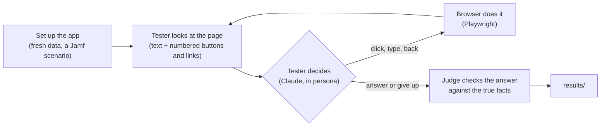

# AI test users

[Back to README](../README.md) · [The results](../docs/RESULTS.md#part-2-ai-test-users)

> **What this is:** five AI testers, each with a persona, use the real app in a real browser and try four real tasks. They see only what a person sees: the page text and the things they can click. They decide one step at a time and give a final answer in their own words. A separate AI judge checks each answer against the facts that are actually true. **AI testers are not real users:** this shows where the app is clear or confusing to someone with no help, not how real people will behave.

## How it works



- **[run.mjs](run.mjs)** sets up the app for each task, opens a real Chromium browser (a phone-sized one for the phone persona), and loops: show the tester the page, ask for one action, do it. At most 15 steps. If a confirmation box pops up (for example before a delete), the tester reads it and decides.
- **The tester** is Claude (Sonnet), called through the local Claude Code app with no tools: it can only act through the browser. Its instructions are the persona and "only use what you see on the screen".
- **The judge** is a separate Claude call. It gets the task, the list of facts a complete answer needs, the tester's answer and, where useful, what the app's data shows afterwards (for example whether the person was really deleted). It marks each fact found or not, and lists anything false or invented. **Pass** means every fact found and nothing false; **partial** means some facts found.
- **[summarize.py](summarize.py)** turns a round into the numbers in [docs/RESULTS.md](../docs/RESULTS.md#part-2-ai-test-users).

## The personas

| Persona | Who | Screen |
|---|---|---|
| Sanne, IT admin | Six years in IT, uses Jamf daily; busy, skims | Laptop |
| Mark, finance manager | Not technical, never seen the app; careful, worried about deleting the wrong thing | Laptop |
| Priya, operations lead | Owns offboarding; knows the business, not Jamf | Laptop |
| Tom, new IT hire | First week; unsure, takes words literally | Laptop |
| Lena, team lead | On her phone between meetings; impatient | Phone |

Full descriptions: [personas.json](personas.json).

## The tasks

| Task | Starting point | A complete answer must say |
|---|---|---|
| **Find what needs action after a sync** | New data waiting in Jamf (Emma left, a laptop vanished) | Emma's MacBook Air is to be collected from Emma Johnson; the Design Team MacBook is no longer in Jamf; it was last with Lucas Brown |
| **Understand a "No longer in Jamf" laptop** | After that sync | Which laptop; that Jamf stopped listing it and why that can happen; who to check with; that it was kept and can be deleted once confirmed |
| **Remove a person who has left** | Alex Smith still has two laptops in Jamf | Alex was deleted (checked in the data); his laptops are kept; he comes back on the next sync; to remove him for good, change Jamf first |
| **Look up a laptop's details** | Normal list | Battery 78%; bought 15 March 2020 |

Full wording and facts: [tasks.json](tasks.json).

## Run it yourself

The app must be running with the simulation's Jamf file (see [simulation/README.md](../simulation/README.md#run-it-yourself)), plus the website (`docker compose -p mdm-portfolio-sim up -d` with the same `MDM_JAMF_MOCK_PATH`). Then:

```bash
cd ai-user-tests && npm install && npx playwright install chromium
node run.mjs --repeat 2 --out results/my-round
python3 summarize.py results/my-round
```

It needs the Claude Code app (`claude`) signed in on the machine. A full round is 40 attempts (5 personas × 4 tasks × 2) and takes about 35 minutes.

## Limits

- **AI testers aren't people.** They read every word on the screen, never get distracted, and can't be confused by the look of a page, only by its words and structure. Treat the results as a first check for clarity, before testing with real people.
- **The judge is also AI.** Each verdict is saved with the facts it found, so it can be checked by hand in `results/*/runs.json`.
- **Small numbers:** 2 attempts per persona and task. Good for finding problems, not for precise rates.
