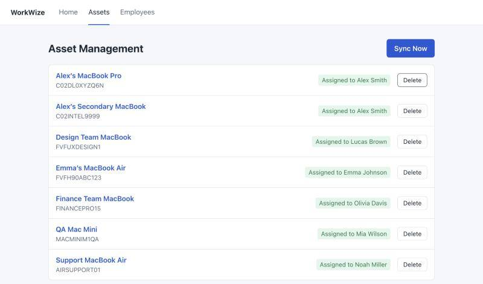
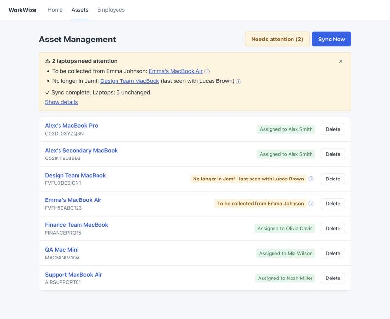
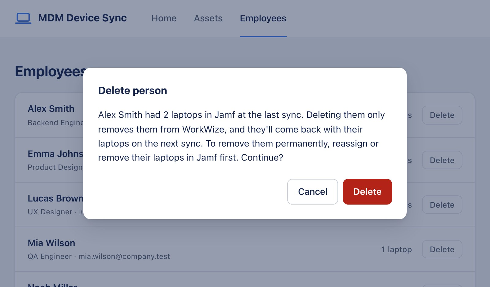
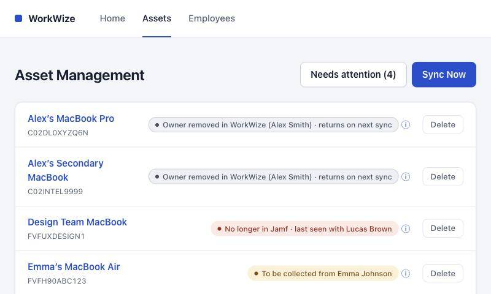
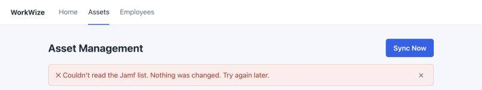
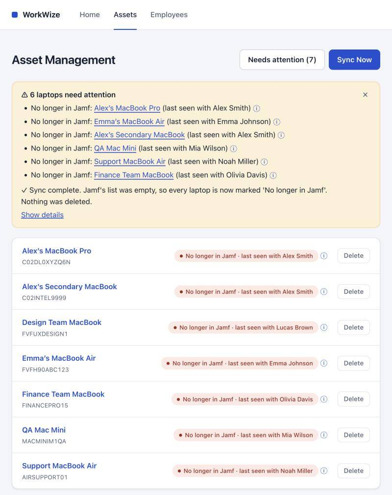
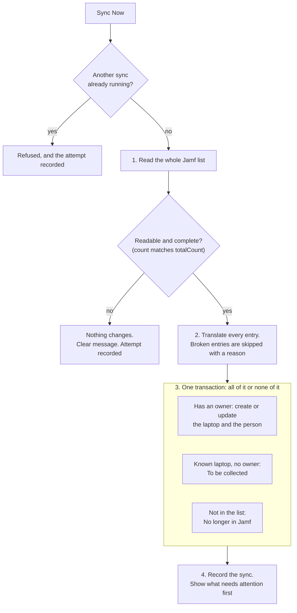
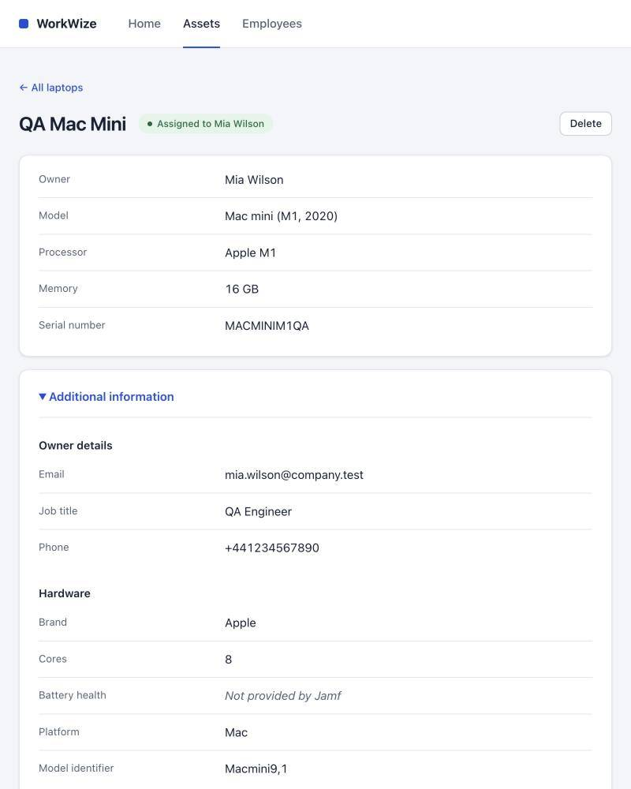
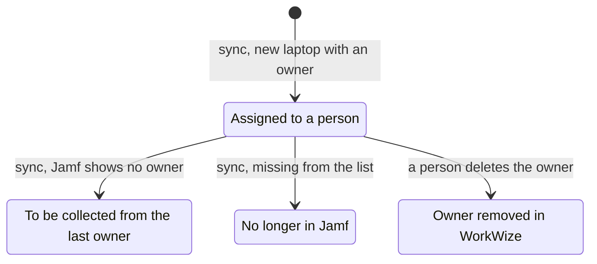

# Decision records

[Back to README](../README.md) · [All docs](../README.md#all-the-docs)

> **What this shows:** how I make product calls. Six decisions, each with the options I turned down, where I changed my mind and the trade-off I accepted. If you read one doc, read this one.

The product decisions behind this app: the situation, the options I looked at, what I chose and why. The short rules are in [DECISIONS.md](DECISIONS.md), and the principles with my quotes are in [PRINCIPLES.md](PRINCIPLES.md). This file adds what those don't show: the options I turned down, where I changed my mind, and the trade-offs I accepted.

How the decisions were made: before any code, claude.ai took me through each situation using a real laptop from the mock data, and gave me options with their pros and cons. I chose and explained why. The quotes are what I said in those sessions, trimmed but not reworded. "Status" says whether it works today.

## 1. The leaver: a known laptop loses its owner in Jamf

**Status:** Built · [DECISIONS.md](DECISIONS.md) row 1 · [P4][p4] [P5][p5] [P9][p9]

**Situation:** Emma's MacBook Air was synced last week. She leaves, and IT removes her as the owner in Jamf. The laptop still exists and still checks in, but it has no owner.

**Options:**
- A. Remove the laptop from WorkWize (the literal reading of "only assigned devices")
- B. Keep it and clear the owner ("assigned to nobody")
- C. Keep it and mark it "To be collected"

Keeping Emma as the owner wasn't an option: that's the bug in the reference code.

**My choice:** C.
> "If it just clears the owner and it's written 'assigned to nobody', then no action is being taken, even though the copy is right. And if the laptop itself is just removed from the copy… then again, no action is being taken."

Collecting laptops is what WorkWize does, so this is the moment that matters most.

| Before: Emma's laptop is assigned | After she leaves: what needs a person comes first |
|---|---|
|  |  |

*The same sync also shows decision 2 (the Design Team MacBook) and the message from 6.1.*

**Follow-ups:**
- WorkWize remembers the last owner's name and email on the laptop, so "collect from Emma Johnson" still works even if Emma is deleted later.
- Emma stays in the people list with zero laptops.

**Changed my mind:** I first said Emma stays "unless she left the company". But WorkWize can't know who left, because Jamf only reports devices. So she always stays.

**Trade-off I accepted:** "To be collected" is a label, not yet a collection workflow, and brand-new laptops without an owner are never imported (brief rule). See [the limitations list][limits].

## 2. The vanished laptop: a known laptop is missing from the Jamf list

**Status:** Built · row 2 · [P1][p1] [P3][p3] [P4][p4] [P14][p14]

**Situation:** Lucas's Design Team MacBook was in last week's list, and today it isn't there at all. It could be retired, lost or stolen, re-enrolled, or a Jamf error. From WorkWize, all four look the same.

**Options:**
- A. Remove it
- B. Keep it and flag it "No longer in Jamf"
- C. Do nothing

**My choice:** B.
> "The worst thing we could do is remove it… If it's an error, it would completely remove the laptop. If it was lost or stolen, nobody would be notified."

> "If you just do nothing, then again the data is lying, because it will still show it is with Lucas."

B is the only option that's safe in all four cases. Its cost is clutter from retired laptops. That takes one delete each, and they don't come back.

The picture under decision 1 shows it: the Design Team MacBook, "No longer in Jamf · last seen with Lucas Brown".

**Trade-off I accepted:** retired laptops stay flagged until someone deletes them. That's one click each, and they don't come back. See [the limitations list][limits].

## 3. Deleting a person who still has laptops

**Status:** Built · row 15 · [P9][p9] [P11][p11] [P12][p12]

**Situation:** Someone deletes Alex, who still has two laptops assigned to him in Jamf. The brief says the delete is local only and the next sync brings Alex back. The question is what happens in between.

**Options:**
- A. Delete Alex and his laptops
- B. Delete Alex and keep the laptops without an owner
- C. Refuse the delete, with instructions
- D. Warn with instructions, then do B

**My first choice:** C.
> "They can't cut the root before cutting the stem. So first, they have to reassign the laptops or remove the laptops in the real source, which is Jamf, first."

**Changed my mind:** claude.ai pointed out that every person in the mock data has a laptop. With C, nobody could ever be deleted, and the brief's rule that a re-sync brings deleted employees back could never be shown. I moved to D: the same root-and-stem instructions, given as a warning. The delete then goes ahead, and the laptops stay, marked "Owner removed in WorkWize".
> "If the 'to be collected' is dependent on the Jamf, but in Decision 3 we're not changing anything in the Jamf, then it would never be collected, which is a good thing because it shouldn't be collected."

This is where [P12][p12] comes from: my first choice was reasonable, but the brief comes first.

| The warning, with the root-and-stem instructions | After the delete: the laptops stay |
|---|---|
|  |  |

*Deleting Alex: the warning says how to remove him for good, and his two laptops are kept until the next sync brings him back.*

**Trade-off I accepted:** a person with laptops can be deleted after a warning, and they come back on the next sync (brief rule). See [the limitations list][limits].

## 4. A broken Jamf list

**Status:** Built · rows 8 and 9 · [P2][p2] [P8][p8]

This decision has two parts.

**An unreadable list** (missing, garbled or cut off): all or nothing. Nothing changes, and the user is told.

*A broken Jamf file: one plain line, and nothing in the list changed.*
> "If we do give an answer with only 90% of the list, then they'll be confused of where the other 10% is… We give either 100% or nothing."

**An empty or suspiciously short list:**
- A. Trust it and apply it
- B. Refuse it if it looks suspicious
- C. Ask before applying

I chose A.
> "A would be the best option because it covers most cases most of the time rather than making the system more complicated… which would then lead to situations like if 5 laptops really were retired, the sync keeps refusing."

This is safe because of decision 2: the worst case is flags, never lost data, and the next good sync clears them. Option C is in [WHAT-I-WOULD-DO-NEXT.md](WHAT-I-WOULD-DO-NEXT.md) as a later improvement.

*An empty list is applied: every laptop is flagged "No longer in Jamf" and nothing is deleted.*

**Added during the build:** a laptop count that doesn't match Jamf's `totalCount` means the list was cut off, so it counts as unreadable. My adjustment: `totalCount` covers all pages, so the check runs after every page has arrived, and a missing count isn't treated as a failure.

*The sync in order. "All or nothing" applies twice: an unreadable list changes nothing, and the changes are saved in one go or not at all.*

**Trade-off I accepted:** an empty list caused by a Jamf hiccup flags every laptop until the next good sync. Nothing is deleted. See [the limitations list][limits].

## 5. Jamf removes a piece of information

**Status:** Built · rows 6 and 7 · [P1][p1] [P6][p6] [P7][p7]

**Situation:** Alex's phone number was in Jamf last week and is blank today. The reference code keeps the old number.

**Options:**
- A. Mirror Jamf (blank means blank)
- B. Keep the old value
- C. Mirror Jamf, with a safety net for required fields

**My choice:** A, with C's safety net.
> "We can't do B because if it's actually been deleted and it still shows, then the system's actually not doing its job."

A blank is usually on purpose, for example for privacy. The safety net is what I called minimum viable information: a person always has a name (it falls back to their email), and a laptop always has a name (it falls back to its model).

**Trade-off I accepted:** a Jamf glitch can blank a field until the next good sync. See [the limitations list][limits].

## 6. The screens

### 6.1 The message after Sync Now

**Status:** Built · [P5][p5] [P13][p13] [P14][p14] [P18][p18]

**Options:**
- A. One short line
- B. The full breakdown every time
- C. What needs attention first, then a short line

There was also a placement question: a pop-up that disappears, or a box that stays until closed.

**My choice:** C, in a box that stays until it's closed.
> "Keep it until closed, hard to miss. Because people can mistakenly close a pop-up because it's a force of habit."

**What I added beyond the options:**
- a "Needs attention" button that stays after the box is closed
- an ⓘ that says what to do

On a normal day, the message is one line.

The picture under decision 1 shows the message after an eventful sync.

**Trade-off I accepted:** after a very large change, the message lists every laptop that needs attention (6,871 lines in testing). See [the limitations list][limits].

### 6.2 The laptop page

**Status:** Built, except two parts that are designed but not built (time): an ⓘ on every field, and the "hasn't checked in" warning

**Options:**
- A. Essentials only
- B. Everything in one long list
- C. Everything, grouped into sections

**My choice:** C, with the essentials first and the rest under "Additional information".
> "Everything has to be there, even though it might not be used by the average user… So everything can be grouped, additional information can be hidden, and then click to open."

*Essentials first, the rest under "Additional information". The Mac mini has no battery, so Jamf sends none: "Not provided by Jamf" (6.2b).*

**Trade-off I accepted:** storage isn't shown, because it isn't in Jamf's data. See [the limitations list][limits].

### 6.2b Wording for missing information

**Status:** Built · [P16][p16]

"Not reported" read like our mistake. I suggested "Not applicable", and claude.ai pointed out that's only sometimes true: a Mac mini really has no battery, but Emma probably does have a phone. We settled on **"Not provided by Jamf"**, which is true every time.

### 6.2c Laptops that stop checking in

**Status:** Designed, not built (time) · [P4][p4] [P5][p5]

I asked for a flag based on the industry standard. The research found Jamf's own guidance: 30 days. The catch was that the mock data is from January, so comparing to today would flag all 7 laptops on the very first sync. I chose to measure against the newest check-in in the same list instead. It's a warning only, not a "Needs attention" item, because an unused laptop is often fine (a spare, or someone on holiday).

**Trade-off I accepted:** the check is measured against the newest check-in in the list, not today, and stale laptops stay out of "Needs attention". See [the limitations list][limits].

### 6.3 The people page

**Status:** Designed, not built (time) · [P5][p5] [P17][p17] [P18][p18]

**Options:**
- A. A simple list
- B. A list with badges, plus a page per person
- C. A list with rows that expand

**My choice:** B.
> "A is not good because it fails the whole 'status leads to action'… C is just a badly designed version of B in my eyes. It's gonna get crowded."

**Changed my mind:** on the badges, I first said "To be collected" is the more important one. Then I decided to show both, since both need a person.

### 6.4 The home page

**Status:** Designed, not built (time). Today, Home shows the totals and Sync Now · [P18][p18]

**Options:**
- A. Home just opens the laptops list
- B. A small overview
- C. A welcome page

**My choice:** B.
> "If two need attention, straight click on the link that's given on the dashboard and it redirects you towards whichever page that attention is needed in, rather than you finding where the thing that needs attention is."

### Visual design

**Status:** Built (after testing) · [P5][p5] [P13][p13] [P18][p18]

After testing, I asked for a visual redesign: wording, behaviour and statuses stay the same, and no Tier 3 features. Claude Code showed the screens and three directions:
- A. Calm ledger: the same top bar, one main colour, white cards, a clear badge per status
- B. Workspace: a left sidebar with icons and denser rows
- C. Status stripe: a coloured header and each laptop as its own card with a coloured edge

**My choice:** A, a clean modern business tool with one main colour. "To be collected" and "No longer in Jamf" had the same colour before; now every status has its own, so the ones that need a person stand out ([P5][p5]). Home keeps exactly what it showed: its overview with attention items is still decision 6.4, designed but not built ([P13][p13], [P18][p18]).

## How the decisions fit together

The decisions were checked against each other before the build:

*The four laptop statuses, all set by a sync except "Owner removed". Any status goes back to "Assigned" when Jamf lists the laptop with an owner, and becomes "No longer in Jamf" when it's missing. A sync never deletes.*

- **Decisions 1 and 3:** "To be collected" only comes from a change in Jamf, never from a delete in WorkWize, so deleting a person never sends anyone to collect a laptop ([P9][p9]).
- **Decisions 1 and 2:** both remove the owner link but keep the last owner, so collection and follow-up always know who to talk to.
- **Decisions 2 and 4:** because a sync never deletes, an empty or short list can be trusted. The worst case is flags that clear on the next good sync ([P3][p3]).
- **Decision 3 and the brief:** people can always be deleted, and they always come back on the next sync.
- **Invalid email and decision 1:** a broken email is skipped, not treated as "no owner", so a typo can't trigger a collection.
- **Decision 5 and the wording:** missing values say "Not provided by Jamf" everywhere.

## Quick approvals

For eight smaller questions, claude.ai recommended an answer and I approved all eight:
1. Real deletes instead of hiding records (this avoids the soft-delete trap)
2. Skip one broken entry instead of rejecting the whole list
3. One sync at a time
4. Tidy up emails and serials before matching
5. Keep a record of every sync
6. Use "Not provided by Jamf" for missing values
7. No storage field (it isn't in the data)
8. Keep stale laptops out of "Needs attention"

Details are in [DECISIONS.md](DECISIONS.md).

Quick approval 5 (a record of every sync), extended by me with the history page and PDF. The history is recorded today. The page (Tier 3) and the PDF (Tier 4) are designed, not built (time).

**Trade-off I accepted:** a real delete keeps no record of what was deleted. See [the limitations list][limits].

## Decisions during the build

- **The same laptop listed twice.** The first rule was "use the first entry". I changed it: if the two entries disagree, Jamf is contradicting itself, so nothing changes for that laptop and both entries are reported. Picking one would be arbitrary. Identical entries are used normally. (row 10b, [P4][p4])
- **The same person with different details on two laptops.** My addition: the first entry in the list wins, so the result is predictable instead of "the last one silently wins". (row 10a, [P7][p7])
- **An invalid email isn't "no owner".** claude.ai worked this out: an email like "alex.smith" is a broken entry and gets skipped. It isn't treated as a laptop with no owner, because otherwise a typo in Jamf would send someone to collect a laptop that's still in use. (row 10, [P9][p9])

## Decisions after testing

Testing found 16 problems, and I decided on each one. The full list is in [TEST-LOG.md](TEST-LOG.md) ("Findings") and [DECISIONS.md](DECISIONS.md) rows 17–25. These are the ones where I didn't just approve the proposal:

- **F1: very long names stopped every sync.** Claude Code proposed cutting them to 255 characters. I chose to store them in full, so nothing is cut and Jamf's data stays as Jamf sent it. Only an over-long serial or email skips that one laptop. ([P1][p1], [P2][p2])
- **F7: dates in an unclear order.** Claude Code recommended accepting only Jamf's exact format. claude.ai suggested also accepting year-first dates, since they can't be misread, and rejecting ambiguous ones like 05/01/2026, showing what Jamf sent. I approved that. ([P4][p4])
- **F10: after a crash, the app said "A sync is already running" for 5 minutes.** Claude Code proposed three changes, including a shorter wait. claude.ai pointed out that the wait wasn't the problem; the untrue message was. I chose that: the 5 minutes stays, the message now says the last sync was interrupted, and the history marks it "interrupted". ([P4][p4])
- **F14 and F15: very large customers.** Kept as limitations, with the measured numbers. They only matter far above a mid-size customer, and the fix belongs with a live Jamf connection. ([P2][p2])
- **F16: a very long owner name covered other people's names.** I chose to let the label wrap rather than keep it as a limitation. ([P4][p4])

[p1]: PRINCIPLES.md#p1-jamf-decides-whats-true-workwize-decides-how-to-show-it-and-what-to-do-about-it
[p2]: PRINCIPLES.md#p2-design-for-the-everyday-customer-make-the-worst-case-safe-and-fixable-dont-complicate-the-everyday-experience-for-rare-cases
[p3]: PRINCIPLES.md#p3-never-lose-data-silently-prefer-flagging-plus-a-human-in-the-loop-over-deleting
[p4]: PRINCIPLES.md#p4-the-data-must-stay-honest-what-the-website-shows-must-match-reality
[p5]: PRINCIPLES.md#p5-a-status-should-lead-to-action
[p6]: PRINCIPLES.md#p6-minimum-viable-information-mvi
[p7]: PRINCIPLES.md#p7-one-source-of-truth-applied-consistently-pick-your-poison
[p8]: PRINCIPLES.md#p8-all-or-nothing-for-unreadable-input
[p9]: PRINCIPLES.md#p9-to-be-collected-is-triggered-only-by-a-change-in-jamf-never-by-an-action-in-workwize
[p11]: PRINCIPLES.md#p11-give-context-and-instructions-not-just-warnings-or-refusals
[p12]: PRINCIPLES.md#p12-the-briefs-requirements-come-before-our-preferences
[p13]: PRINCIPLES.md#p13-simple-on-the-surface-complexity-only-where-its-needed-the-right-amount-of-engineering
[p14]: PRINCIPLES.md#p14-things-clear-themselves-when-theyre-done
[p16]: PRINCIPLES.md#p16-never-make-a-gap-look-like-our-mistake-and-never-say-something-thats-only-sometimes-true
[p17]: PRINCIPLES.md#p17-the-context-ladder-never-leave-something-blank-if-context-exists
[p18]: PRINCIPLES.md#p18-take-people-straight-to-the-problem-dont-make-them-search
[limits]: IDEAS-AND-LIMITATIONS.md#known-limitations--shortcuts
