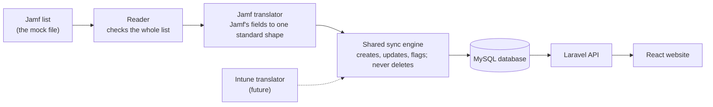

# For engineers

[Back to README](../README.md) · [All docs](../README.md#all-the-docs)

How to run it, where to look in the code, and how the sync service is put together. The product story is in the [README](../README.md).

## Start the app

You only need [Docker Desktop](https://www.docker.com/products/docker-desktop/).

```bash
docker compose up
```

The first start takes a few minutes (Docker downloads MySQL, PHP and Node and installs the libraries). After that it starts in under a minute.

When it's ready, open:

| What | Address |
|---|---|
| Website | http://localhost:5173 |
| Backend health check | http://localhost:8000/api/health |

Press **Sync Now** on the website to import the laptops from the Jamf mock file. If Sync Now is pressed twice at once, Laravel's development server handles the two one after the other; the lock that refuses a second sync running at the same time is proven by its test ([SyncLockTest](../backend/tests/Feature/Mdm/SyncLockTest.php)).

## Stop or reset

```bash
docker compose down        # stop
docker compose down -v     # stop and delete the database (fresh start next time)
```

## Run the tests

With the app running:

```bash
docker compose exec backend php artisan test   # backend
docker compose exec frontend npm test          # website
```

What the tests cover, and how we check that they can fail: [TEST-LOG.md](TEST-LOG.md).

## Try a scenario

To see "To be collected", "No longer in Jamf", an empty list or a failed sync without editing WorkWize's mock file, start the backend with a scenario file, press Sync Now, then go back to normal. The scenarios are described in [backend/tests/Fixtures/jamf/README.md](../backend/tests/Fixtures/jamf/README.md).

```bash
MDM_JAMF_MOCK_PATH=/var/www/backend/tests/Fixtures/jamf/emma-leaves.json docker compose up -d backend
docker compose up -d backend   # back to the real mock file
```

## Code tour (about 10 minutes)

The six places to open first, in this order:

| # | File | What to look for |
|---|---|---|
| 1 | [`backend/app/Mdm/Jamf/JamfDeviceMapper.php`](../backend/app/Mdm/Jamf/JamfDeviceMapper.php) | The Jamf translator, the only code that knows Jamf's field names. A broken entry becomes a skip with a reason; a value it can't read is kept as sent, never guessed |
| 2 | [`backend/app/Mdm/MdmSyncService.php`](../backend/app/Mdm/MdmSyncService.php), `run()` | The sync engine in three steps: read the whole list (nothing changes if it can't be read), translate, then save everything in one transaction. `apply()` sets "To be collected"; `flagMissing()` flags laptops missing from the list and never deletes |
| 3 | [`backend/app/Mdm/MdmSyncService.php`](../backend/app/Mdm/MdmSyncService.php), `sync()` | The lock: one sync at a time, a refused attempt is recorded, and after a crash `refusalMessage()` says "interrupted" instead of "already running" |
| 4 | [`backend/app/Actions/DeleteEmployee.php`](../backend/app/Actions/DeleteEmployee.php) | Deleting a person: their laptops are kept and marked "Owner removed in WorkWize", never "To be collected" |
| 5 | [`frontend/src/lib/labels.js`](../frontend/src/lib/labels.js) | What each status says on screen, with the last owner's name |
| 6 | [`backend/tests/Feature/Mdm/SyncEngineTest.php`](../backend/tests/Feature/Mdm/SyncEngineTest.php), `test_t8_laptop_missing_from_the_list_is_flagged_not_deleted` | One test and its deliberate break: switching the flagging off, or deleting flagged laptops, makes it fail. Every rule was checked this way ([TEST-LOG.md](TEST-LOG.md#how-we-check-that-a-test-can-fail)) |

## Where the improved sync service lives

The brief asks for an improved version of WorkWize's reference `RefJamfSyncService` (their code, not included in this public copy). Instead of one class that both reads Jamf's data and saves it, the sync is split into three parts:



*How a sync flows. Each MDM tool gets its own small translator; the engine, the database and the website are shared.*

| Part | File | What it does |
|---|---|---|
| Reader | [JamfProvider.php](../backend/app/Mdm/Jamf/JamfProvider.php) | Reads the Jamf mock file and checks the whole list before handing anything over |
| Translator | [`backend/app/Mdm/Jamf/JamfDeviceMapper.php`](../backend/app/Mdm/Jamf/JamfDeviceMapper.php) | The only place that knows Jamf's field names. Turns one Jamf laptop into a standard shape, or skips it with a reason |
| Shared sync engine | [`backend/app/Mdm/MdmSyncService.php`](../backend/app/Mdm/MdmSyncService.php) | All the saving logic, for any MDM tool: creates, updates, follows reassignments, all in one transaction |

Why it's split: adding another MDM tool (Intune, Kandji) means writing one reader and one translator. The engine, the database and the website stay the same. A test proves this with a made-up second tool.

### Improvements over the reference

| # | Reference weakness | What we did | Status | Proved by |
|---|---|---|---|---|
| R1 | Reading Jamf and saving were mixed in one class | Reader, translator and shared engine | Fixed | [SyncEngineTest](../backend/tests/Feature/Mdm/SyncEngineTest.php): engine works for another provider |
| R2 | A laptop that lost its owner in Jamf kept its old owner | Marked "To be collected from {last owner}", owner link removed | Fixed | SyncEngineTest t5 |
| R3 | Laptops missing from Jamf stayed forever | Flagged "No longer in Jamf · last seen with {last owner}", never deleted; the flag clears if the laptop comes back | Fixed | SyncEngineTest t8, t9, t15, t16 |
| R4 | A phone number removed in Jamf was kept | Removed values are removed here too | Fixed | SyncEngineTest t17 |
| R5 | A new person without a name could crash the save | Name falls back to the email; laptop name to the model | Fixed | SyncEngineTest t18, t19 |
| R6 | Storage always empty; most specs thrown away | Every Jamf field is kept (storage isn't in the mock) | Fixed | [JamfDeviceMapperTest](../backend/tests/Unit/Mdm/JamfDeviceMapperTest.php): Alex's MacBook Pro field by field |
| R7 | "Updated" counted laptops that didn't change; no people counts | Only real changes count; people counted too | Fixed | SyncEngineTest t2, t3 |
| R8 | Two syncs at once could collide | Only one sync runs at a time; a second one is refused with "A sync is already running" and recorded | Fixed | [SyncLockTest](../backend/tests/Feature/Mdm/SyncLockTest.php) t25 |
| R9 | No tidying of serials and emails; the same serial processed twice | Tidied; conflicting duplicates change nothing and are reported | Fixed | SyncEngineTest t23, t24 |
| R10 | Odd fallback that used the username as an email | Removed; an invalid email skips that entry | Fixed | SyncEngineTest t22 |
| R11 | No record of when syncs happened | Every attempt is stored: when, result, counts, skips, and the reason if it failed | Fixed | [SyncHistoryTest](../backend/tests/Feature/Mdm/SyncHistoryTest.php) |
| R12 | No pagination | The completeness check already works across pages; paging itself isn't needed for the one-page mock | Partly | [JamfProviderTest](../backend/tests/Feature/Mdm/JamfProviderTest.php): count mismatch stops the sync |
| R13 | Unclear what happens when something breaks halfway | The whole list is checked first; everything is saved in one transaction; one bad entry is skipped with a reason | Fixed | SyncEngineTest t14, t21, crash halfway saves nothing |
| R14 | One database query per laptop | Measured: about 3 queries per laptop; 5,000 laptops sync in about 3 seconds, 12,000 in about 7. Listed as a limitation | Not yet | [TEST-LOG.md](TEST-LOG.md), "Scale" |

Tiers are explained at the top of [DECISIONS.md](DECISIONS.md); what's designed but not built is listed in [WHAT-I-WOULD-DO-NEXT.md](WHAT-I-WOULD-DO-NEXT.md#designed-not-built).

## Project layout

| Folder | What's in it |
|---|---|
| `backend/` | Laravel API (PHP 8.4, Laravel 13.35) |
| `frontend/` | React website (React 19, Vite) |
| `files/` | The Jamf mock response from WorkWize (made-up data). Their reference sync code and wireframe are not included in this public copy |
| `docs/` | The documents listed in the README's "All the docs", and their screenshots in `docs/screenshots/` |

## Notes

- Local development setup only. The passwords in `docker-compose.yml` are local-only values, and the website and backend are only reachable from this computer.
- Debug mode is on (`APP_DEBUG=true` in `backend/.env.example`), which suits local development; it should be off anywhere else.
- WorkWize's template link returned a 404, so this repo was created fresh and the template's files were copied in unchanged.
