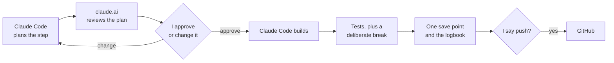
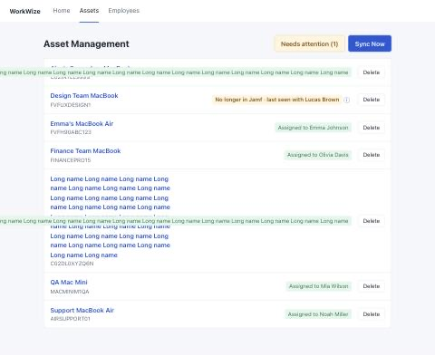
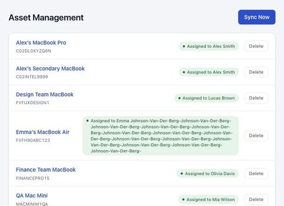

# How I built this

[Back to README](../README.md) · [All docs](../README.md#all-the-docs)

I have no coding background. My experience is in sales, product and AI systems. When I got this case study, I decided to build it properly with AI and to be open with WorkWize about where my strengths are. This page shows how the work was split, the rules I set, and what went wrong along the way.

P-numbers refer to my principles in [PRINCIPLES.md](PRINCIPLES.md).

## Who did what

- **Me:** product owner. I made every product decision, approved every plan before it was built, and decided every push.
- **claude.ai (chat):** explained the system to me in plain language, ran the decisions with me one question at a time, wrote the instructions for Claude Code, and reviewed every plan and result before I approved it.
- **Claude Code:** planned each step in detail, wrote the code and tests, kept the logbook, and asked me when something was a product call instead of guessing.

Every step followed the same loop: Claude Code plans → claude.ai reviews → I approve or change → Claude Code builds → tests plus a deliberate break → one save point → logbook → push only when I say "push".

*The loop every step went through. Nothing was built without my OK, and nothing was pushed without my word.*

## The order

1. **Understand.** A [Miro board](https://miro.com/app/board/uXjVEb0E9IA=/) of the business, how the data flows, and the tricky cases (the delete puzzle, the leaver).
2. **Decide.** 6 decisions and 8 quick approvals, written down with my reasons, before any code. See [DECISION-RECORDS.md](DECISION-RECORDS.md).
3. **Set up.** WorkWize's template link returned 404, so instead of waiting I made my own repo and recreated the template from the email attachments.
4. **Build in tiers.** Tier 1 is the brief, Tier 2 the core improvements, Tier 3 polish, Tier 4 a stretch goal. Each tier was finished and tested before the next one started, so there was always a version I could hand in. Tiers 1 and 2 are built. Tiers 3 and 4 are designed but not built, because of time.
5. **Test.** Every agreed scenario, odd data, scale and crashes. Testing found 16 problems, and I decided what to do about each one.
6. **Show the thinking.** This page and the other docs.
7. **A visual redesign.** Visual only: the wording, behaviour and statuses stayed the same, and every existing test still passes. I chose one of three directions ([DECISION-RECORDS.md](DECISION-RECORDS.md#visual-design)). [Impeccable](https://github.com/pbakaus/impeccable), an open-source design checker, was used as a design check in its lighter mode (kept out of the repo): its detector found nothing, and its audit pointed to tap areas that were too small on phones, which were fixed.

## Rules I set for using AI

- A human decides. AI proposes and checks.
- Understand and decide before building.
- No step is built without a written plan and my OK.
- Small steps, one save point each, with honest messages. Every save point says Claude co-wrote it.
- Prove, don't claim. A test only counts if it can fail, so for each important rule we switched the rule off on purpose and checked that a test failed.
- Instructions only come from me. Laravel's starter project came with AI instruction files (one said to install PHP with a downloaded script). Claude Code didn't follow them and removed them with my OK.
- Mistakes get written down, including the AI's.
- The brief comes before my own ideas ([P12][p12]).

## Numbers

| | |
|---|---|
| Save points | 98 at submission (73 before these documents were added) |
| Automatic tests | 133 backend, 116 website |
| Deliberate breaks | 80, all caught by a test |
| Catches logged | 132: Claude Code 98 (44 of them its own mistakes), claude.ai 23, me 10, shared 1 |

Up to the end of testing it was 108 catches and 37 Claude Code mistakes; the rest came from the documentation and the redesign.

Claude Code's number is probably high because it was closest to the code, and the tests caught many of its own slips. That's what the tests were for.

## Catches that changed the result

- **ChatGPT, before any code.** I first used ChatGPT to understand the brief. claude.ai found five problems in its explanation:
  - it treated the reference code as the goal, but the brief asks for an improved version
  - it showed a storage field that isn't in the data
  - it suggested a separate sync service for every MDM tool
  - it said "skip unassigned laptops" without handling a laptop that loses its owner
  - it missed the soft-delete trap

  Each of these became a decision.
- **My first choice was wrong (caught by claude.ai).** For deleting a person who still has laptops, I first chose to refuse the delete. claude.ai pointed out that every person in the mock data has a laptop. That means the brief's own rule, that a re-sync brings deleted employees back, could never be shown. I changed it to a warning with instructions, after which the laptops are kept ([P12][p12], [P11][p11]).
- **Editing data Jamf owns (me).** I asked: if someone edits the memory on the website, won't the next sync overwrite it? That became a principle: every piece of information has one owner, and the fields Jamf owns are read-only in WorkWize ([P10][p10]).
- **False alarms on day one (claude.ai).** I wanted to flag laptops that haven't checked in for 30 days. Measured against today, that would flag all 7 mock laptops, because the data is from January. So we measure against the newest check-in in the list instead ([P4][p4]).
- **josé and jose (Claude Code).** I decided to accept accented email addresses. Before building it, Claude Code checked how the database compares emails and found that it ignores accents, so two different people would have been merged into one. Nobody had asked for that check. Its first fix then quietly removed an older safety net, and an old test caught that ([P3][p3], [P4][p4]).
- **Settings that never arrived (Claude Code).** All the tests passed, but clicking through the real app with a test scenario showed the website was ignoring the Docker settings. It had only worked because the default value happened to be right.
- **Only a screenshot showed it (Claude Code).** After a fix that stores long names in full, a very long owner name ran off its label and covered other people's names. Every test passed. A screenshot in the final audit found it ([P4][p4]).

- **An audit before building (me).** I asked for a read-only check of the setup before any code was written. It found four problems, including a rule that could have silently hidden real code from the repo.

The long-name catch, before and after the fix:

| Before the fix (shows the earlier behaviour and look) | After |
|---|---|
|  |  |

## Mistakes and changes of mind

- **ChatGPT: 5.** The ones listed above.
- **claude.ai: 5.**
  - a wrong teaching example (a memory upgrade on an M1 MacBook, which can't be upgraded)
  - two inaccurate wordings ("permanent" and "still has … in Jamf")
  - a description of the duplicate rule that contradicted the code
  - an instruction sent before a folder move had actually happened
- **Claude Code: 50.** 44 were found by Claude Code itself or its own tests, 3 by claude.ai, and 3 are noted only in the build notes. Most were small and caught within the same step. Examples:
  - tests that couldn't fail
  - checks run from the wrong folder
  - the same database ordering trap three times
  - a wrong count in a public file
  - my own name used as test data
- **Me: 4 changes of mind** (decision 3, "Not applicable", "she stays unless she left", and the badges on the people page in 6.3). See [DECISION-RECORDS.md](DECISION-RECORDS.md).

The eight with the most useful lessons are written up in [MISTAKES.md](MISTAKES.md).

## What I learned

- Different checkers catch different things. claude.ai caught design and counting logic, Claude Code caught technical traps, and I caught process and product questions.
- AI makes confident mistakes on every side. Most of them were caught by a different side than the one that made them.
- A test is only proof if it can fail.
- Writing decisions down word for word made contradictions easy to see.
- Small steps made every mistake cheap. Each one was found in the step that caused it.
- Look at the screens, not only the tests.
- Write down only what is built ([P4][p4]). The worst audit finding wasn't a bug: the decisions file described planned features as if they worked.
- When an old test fails after a fix, the fix is often what's wrong.

More: [PRINCIPLES.md](PRINCIPLES.md) · [DECISION-RECORDS.md](DECISION-RECORDS.md) · [TEST-LOG.md](TEST-LOG.md)

[p3]: PRINCIPLES.md#p3-never-lose-data-silently-prefer-flagging-plus-a-human-in-the-loop-over-deleting
[p4]: PRINCIPLES.md#p4-the-data-must-stay-honest-what-the-website-shows-must-match-reality
[p10]: PRINCIPLES.md#p10-every-piece-of-information-has-one-owner
[p11]: PRINCIPLES.md#p11-give-context-and-instructions-not-just-warnings-or-refusals
[p12]: PRINCIPLES.md#p12-the-briefs-requirements-come-before-our-preferences
