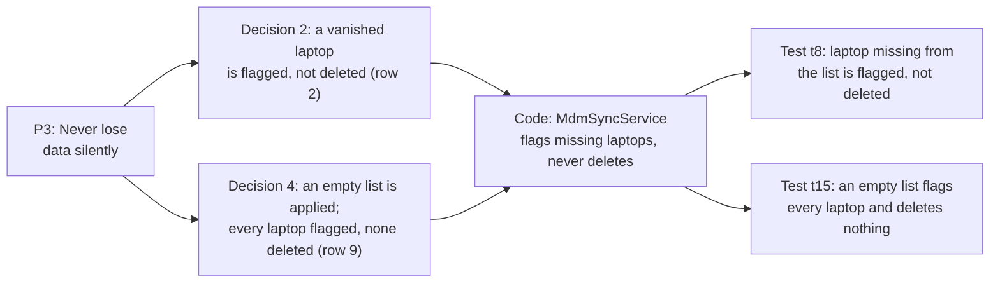

# Principles

These are the rules behind every decision in this project. They came from Muhammad's answers while the decisions were made (in sessions with claude.ai, before any code was written), and from a few later moments in the build. The quotes are his words as recorded then, unpolished. **[Our addition]**

The numbers (P1–P18) are used across the docs and the code. Where each one shows up in the code and the tests: the [traceability table](#traceability-principle--decision--code--test) at the end. "Decision n" refers to the six big decisions made before the build: 1 the leaver, 2 the vanished laptop, 3 deleting a person who has laptops, 4 a broken Jamf list, 5 Jamf removing a value, 6 the screens (6.1 the sync message, 6.2 the laptop page, 6.3 the people page, 6.4 the home page). Each is written up with its options and reasons in [DECISION-RECORDS.md](DECISION-RECORDS.md).

---

### P1: Jamf decides what's true. WorkWize decides how to show it and what to do about it.
> "Jamf is the source of truth and is the final decision, right? However, how we show it and the context we show the Jamf truth depends on WorkWize."

- **From:** Decision 2 (the vanished laptop).
- **Applied:** [DECISIONS.md](DECISIONS.md) rows 1, 2, 5, 6, 17. WorkWize never edits Jamf's facts; it only labels them.

### P2: Design for the everyday customer. Make the worst case safe and fixable. Don't complicate the everyday experience for rare cases.
> "In each of these decisions, you see the worst case scenario, you see whether it satisfies the average daily customer rather than an edge case customer. So we can minimize decision fatigue and [not] overcomplicate simple processes just because of the edge case and to accommodate it."

> "A would be the best option because it covers most cases most of the time rather than making the system more complicated to adjust for edge cases but then making UI/UX complicated for majority cases."

- **From:** Decisions 5 and 4.
- **Applied:** rows 9, 10, 17, 21, 24. One broken entry is skipped; a harmless format difference never stops a sync; very large customers are a written-down limitation, not extra screens for everyone.

### P3: Never lose data silently. Prefer flagging plus a human in the loop over deleting.
> "We keep it so at least nothing is lost, which is the priority, right? We don't want to remove things. And the customer is notified, so the human in the loop happens."

> "We don't want to do something that deletes data without giving context to the person. This is something that we need to be staying consistent with throughout our decisions."

- **From:** Decisions 2 and 3.
- **Applied:** rows 1, 2, 9, 14–16, 20. A sync never deletes. Found during the fixes: the database treated "jose@…" and "josé@…" as the same person, which would have merged two people's laptops (row 20).

### P4: The data must stay honest. What the website shows must match reality.
> "Even like the front end, the UI React website, is not really showing that that particular client or company actually still has a laptop. So now the data is not honest either."

> "If you just do nothing, then again the data is lying."

- **From:** Decisions 1 and 2.
- **Applied:** rows 1, 2, 6, 18, 19, 20, 22. "To be collected" and "No longer in Jamf"; a value Jamf sent but WorkWize can't read is shown as sent, never guessed; "already running" only while it's true.

### P5: A status should lead to action.
> "If it just clears the owner and it's written 'assigned to nobody', then no action is being taken, even though the copy is right."

- **From:** Decision 1.
- **Applied:** rows 1, 2, 23; the "Needs attention" button; "taking longer than usual" after 15 seconds of waiting.

### P6: Minimum Viable Information (MVI)
> "There are certain fields that just stay regardless. So we put a safety net. So there's a minimum viable information... The name has to be the minimum viable information. So the MVI, we call it."

- **From:** Decision 5.
- **Applied:** row 7. A person always has an email and a name (the name falls back to the email); a laptop always has a serial and a name (falls back to the model).

### P7: One source of truth, applied consistently ("pick your poison").
> "We need at least one source of truth over the other. It's a pick a poison type of scenario... If the Jamf is the source of truth, then it needs to be source of truth for whatever the information is, even if that's the number, the email. Regardless."

- **From:** Decision 5.
- **Applied:** rows 5, 6, 10a. Every Jamf field follows Jamf, including removals; within one sync, a person's details come from their first entry, one predictable rule.

### P8: All or nothing for unreadable input.
> "We give either 100% or nothing."

- **From:** Decision 4.
- **Applied:** row 8. An unreadable or incomplete list changes nothing; a sync that crashes halfway saves nothing (proved in real crashes during testing).

### P9: "To be collected" is triggered only by a change in Jamf, never by an action in WorkWize.
> "To be collected only happens if the Jamf is changed directly, and a final decision is actually made to go through the recollection process."

- **From:** Decision 3.
- **Applied:** rows 1, 10, 15. Deleting a person gives their laptops "Owner removed in WorkWize", not "To be collected"; an invalid email skips the entry instead of raising a false "To be collected".

### P10: Every piece of information has one owner.
> "Imagine it's changed on the React interface. Then what happens? Because on the next sync, it will just go back to 16 or whatever it was before, right?"

- **From:** a question in Phase 1 (understanding the system), before any decision.
- **Applied:** no editing anywhere in WorkWize (brief); wrong data is fixed in Jamf. The API refuses edits with a plain explanation.

### P11: Give context and instructions, not just warnings or refusals.
> "We're not warning them. We're giving them now instructions. If they do want to delete, they have to do certain things first. They can't cut the root before cutting the stem."

- **From:** Decision 3.
- **Applied:** rows 15, 22, 23; every confirmation and error message says what happened and what to do. Technical errors never reach the screen.

### P12: The brief's requirements come before our preferences.
No quote: learned in Decision 3. Muhammad's first choice there (refuse to delete a person who has laptops) was well reasoned, but it would have made a brief requirement ("re-sync recreates deleted employees") impossible to show with WorkWize's own test data. The final decision kept his principle (context and instructions) inside a design that meets the brief.

- **Applied:** row 15; rows 1 and 4 (unassigned laptops are never imported, as the brief says).

### P13: Simple on the surface, complexity only where it's needed ("the right amount of engineering").
> "We design everything for the worst case scenario. But we make sure the best case scenario is easy and direct and is not affected by additional steps. So only when it goes down to the worst case scenario are those additional steps actually seen and made more complicated, because that complication is needed. That's not over engineering. That's the right number of engineering. But if we show everything at once, even for a normal day, then that's over engineering."

> "Just because we're making stuff simple for the daily user does not mean all of the information will not be there. It will be there, but... you can only really see it if you intentionally want to see it."

- **From:** Decisions 6.1 and 6.2 (the sync message and the laptop page).
- **Applied:** the screens section of [DECISIONS.md](DECISIONS.md): zero counts hidden, "Show details", "Additional information" closed by default.

### P14: Things clear themselves when they're done.
> "We show what needs the human-in-the-loop action, but we also clear whatever is done."

- **From:** Decision 6.1 (the sync message).
- **Applied:** row 2 ("No longer in Jamf" clears itself when the laptop comes back); the "Needs attention" button disappears at zero.

### P15: Context everywhere, on demand (the info symbol).
> "Each thing that is shown has the information symbol on it. So if you click it, then it shows what this actually is, what this means. So context is given heavily."

> "Everything that needs attention has an information button where if you click the information button, it tells you what to do or what to check."

- **From:** Decision 6.
- **Applied:** ⓘ next to every status that needs a person, and next to "Jamf sent a value WorkWize couldn't read". An ⓘ on every other field is designed, not built (Tier 3; time), so this principle is only partly built.

### P16: Never make a gap look like our mistake, and never say something that's only sometimes true.
No single quote: it came from Muhammad's point that "Not reported" "reads like a mistake on our end when it's actually a systemic issue we can't resolve", and his refinement that "Not applicable" is only true for some missing fields.

- **From:** Decision 6.2b (wording for missing information).
- **Applied:** rows 6 and 18: "Not provided by Jamf" for gaps; a separate label when Jamf did send something WorkWize can't use.

### P17: The context ladder: never leave something blank if context exists.
> "Try not to, in most cases, leave anything blank. If you can give context, then give context. And if you can give further context with the information button, then that's even better. So essential context is priority... It goes in stages, right? If you have the info, you give both levels of info. If you don't have enough, you just give basic essential one. And if you don't have anything, then you give nothing. That's a design decision that we've made."

- **From:** Decision 6.3 (the people page).
- **Applied:** "No laptops", "Not provided by Jamf", empty-list texts, ⓘ explanations.

### P18: Take people straight to the problem. Don't make them search.
> "If two need attention, straight click on the link that's given on the dashboard and it redirects you towards whichever page that attention is needed in, rather than you finding where the thing that needs attention is. So that's convenience."

> "We just give them the essential and then if they want more they can navigate their way, and we can help them navigate as well."

- **From:** Decision 6.4 (the home page).
- **Applied:** every laptop in the sync message's attention list links to its page; the "Needs attention" filter.

---

## Traceability: principle → decision → code → test

Decisions are rows in [DECISIONS.md](DECISIONS.md). Code is where the rule lives (marked with the P-number in a comment). Tests are named as in the code; backend tests are PHP, website tests are the `it(…)` names. Checked against the code on 15 Oct 2026.

One principle followed all the way through, as an example:

*From principle to proof: P3 shaped two decisions, the sync engine carries them out, and two tests fail if it ever deletes a laptop.*

| Principle | Decisions | Code | Tests that prove it | Honest note |
|---|---|---|---|---|
| P1 Jamf decides what's true | 1, 2, 5, 6, 17 | `MdmSyncService` (mirror every detail; "to be collected"); long-text migration | `t3_ram_change_is_reflected_and_counted_once`, `t4_reassigned_laptop_follows_jamf`, `f1_long_text_is_stored_in_full…` | – |
| P2 Everyday customer first; worst case safe | 9, 10, 11, 17, 21, 24 | `JamfDeviceMapper` (over-long serial skips one entry), `JamfProvider` (count as text, invisible marker), `MdmSyncService` (broken entries skipped) | `t21_entry_without_serial_is_skipped_and_the_rest_synced`, `f4_…`, `f9_…`, `f1_…` | F14 and F15 are limitations accepted under this principle |
| P3 Never lose data silently | 1, 2, 9, 10b, 14–16, 20 | `MdmSyncService` (flag, never delete); email-comparison migration | `t8_laptop_missing_from_the_list_is_flagged_not_deleted`, `t15_an_empty_list_flags_every_laptop_and_deletes_nothing`, `f6_accented_emails_are_accepted_and_jose_and_josé_are_two_people` | – |
| P4 The data must stay honest | 1, 2, 3, 10b, 11–13, 18–20, 22 | `MdmSyncService` (conflicting duplicates, honest refusal), `JamfDeviceMapper` (never guess; serial spaces), `Unreadable.jsx` | `t23_conflicting_duplicates_change_nothing…`, `f7_dates_in_an_ambiguous_order_are_never_guessed`, `f5_…`, `f10_after_a_crash_the_refusal_says…`; website: "shows what Jamf sent when WorkWize could not read it" | Row 13 (stale warning) isn't built yet |
| P5 A status should lead to action | 1, 2, 13, 23 | `MdmSyncService` ("to be collected"), `syncMessage.js` (attention first), `useTakingLong.js` | `t5_known_laptop_that_loses_its_owner_is_to_be_collected`, `t27_laptops_that_newly_need_attention_are_listed_by_name_once`; website: "leads with the laptops that newly need attention", "F13: says when a sync takes longer than usual" | – |
| P6 Minimum Viable Information | 7 | `JamfDeviceMapper` (name falls back to email / model) | `t18_t19_missing_names_fall_back`, `blank_person_name_falls_back_to_email`, `blank_laptop_name_and_model_fall_back_to_unknown_device` | – |
| P7 One source of truth, applied consistently | 3, 5, 6, 10a, 19 | `JamfDeviceMapper` (blank means blank), `MdmSyncService` (first entry wins) | `t17_phone_removed_in_jamf_is_removed_here`, `person_details_come_from_their_first_entry_in_the_list`, `t24_messy_email_and_serial_match_existing_records` | – |
| P8 All or nothing | 8 | `JamfProvider` (count check), `MdmSyncService` (one transaction) | `t14_unreadable_list_changes_nothing`, `count_mismatch_means_an_incomplete_list_and_stops`, `crash_halfway_saves_nothing` | Also held in real crashes during testing (5.3, 5.4) |
| P9 "To be collected" only from a Jamf change | 1, 10, 15 | `MdmSyncService`, `JamfDeviceMapper` (invalid email ≠ no owner), `DeleteEmployee` | `t12_deleting_a_person_keeps_their_laptops_as_owner_removed`, `t22_invalid_email_for_a_known_laptop_leaves_it_unchanged` | – |
| P10 One owner per piece of information | 14 | `routes/api.php` (read and delete only) | `editing_or_creating_records_is_refused_with_a_plain_message` | – |
| P11 Context and instructions, not just warnings | 8, 15, 16, 22, 23 | `PlainErrors.php`, `bootstrap/app.php`, `api.js`, `confirmations.js` | `PlainErrorsTest` (3), `f10_…`; website: "tells someone deleting a person with laptops to reassign them in Jamf first", "F2/F12: a technical error page is never shown" | – |
| P12 The brief comes first | 4, 14, 15 | Only as following the brief's rules (e.g. new laptops without an owner aren't imported) | `t6_new_laptop_without_owner_is_skipped`, `t13_deleted_person_comes_back_with_their_laptops` | A principle about how decisions were made; it has no code of its own |
| P13 Simple on the surface | 24; Screens | `syncMessage.js` (zeros hidden, "Show details"); "Additional information" on the laptop page | website: "shows one line on a normal day and hides zeros", "keeps every count, zeros included, for Show details", "keeps additional information closed until asked for" | – |
| P14 Things clear themselves | 2; Screens | `MdmSyncService` (flags clear), `AssetsPage.jsx` (button disappears) | `t16_the_next_good_sync_clears_the_flags`, `t9_missing_laptop_that_comes_back_follows_the_list`; website: "t28: … disappears once the last one is deleted" | – |
| P15 Context on demand (ⓘ) | Screens | `InfoButton.jsx` | website: "has an ⓘ explanation next to statuses that need a person", "shows what Jamf sent … with an explanation" | **Partly built.** ⓘ on statuses that need a person and on the new "couldn't read" label; ⓘ on every other field is designed, not built (Tier 3; time) |
| P16 Never make a gap look like our mistake | 6, 18 | `format.js` ("Not provided by Jamf"), `Unreadable.jsx`, `JamfDeviceMapper` | website: "says Not provided by Jamf instead of leaving a gap"; `f8_impossible_values_are_shown_as_sent_and_missing_ones_stay_missing` | – |
| P17 The context ladder | 7, 18 | `format.js` | website: "lists people with their laptop counts, never blank or 0", "never shows an empty name" | – |
| P18 Take people straight to the problem | Screens | `syncMessage.js` / `LatestMessage.jsx` (links) | website: "syncs, shows the full box until closed, and reloads the list" (checks the link to the laptop), "shows totals with real singular and plural" (Home links) | **Partly built.** The Home attention list and people badges are designed, not built (Tier 3; time) |
