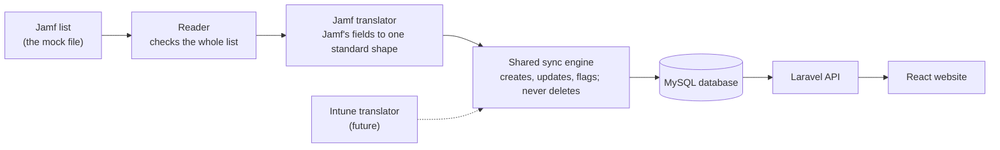

# Product notes

Observations from building this, from a product and business point of view. They go beyond the brief. Where an idea came from the AI side, I say so.

## The delete puzzle

The brief says delete removes something from WorkWize only, so the next sync brings it back. It's built that way. But in a real product, someone pressing delete probably means one of three things:

- **"Hide this."** That needs a hide or archive that survives syncs.
- **"This laptop is retired."** That should be fixed in Jamf, so it stops coming back.
- **"This data is wrong."** A re-sync already fixes it.

claude.ai pointed this out early on. I decided how to handle it. For now the app answers it with instructions instead of a new feature: deleting a person who still has laptops shows a warning that explains how to remove them for good, in Jamf ([P11][p11]). A "hide" or "retired" that survives syncs is in [WHAT-I-WOULD-DO-NEXT.md](WHAT-I-WOULD-DO-NEXT.md).

## The leaver moment

The brief says unassigned devices are skipped. But when an employee leaves, Jamf reports their laptop with no owner, and that's when the laptop needs collecting, which is WorkWize's business. Skipping it would hide that moment.

claude.ai pointed this out early on. I decided how to handle it. I chose to turn it into "To be collected" (decision 1): a known laptop that loses its owner shows "To be collected from {last owner}" ([P5][p5]).

One limit remains: WorkWize can't tell whether someone left the company, because Jamf only reports devices. Knowing that would need a connection to HR.

## One owner per piece of information

While learning how the system works, I asked: if someone changes the memory on the website, won't the next sync just overwrite it? It would, and the user would lose their edit without knowing. So every piece of information has one owner ([P10][p10]).

- **Jamf owns the device facts.** They're read-only here, and wrong data is fixed in Jamf.
- **WorkWize owns what it adds on top.** Today that's the statuses and the last owner. In a real product it would also cover purchase, warranty and collection.

Whether WorkWize should ever write changes back to Jamf is a question I'd like to ask the team.

## Missing information

In the mock data, Jamf leaves some fields empty: the Mac mini has no battery, and some people have no phone number. "Not reported" made it look like WorkWize had failed. I suggested "Not applicable", and claude.ai pointed out that's only sometimes true. "Not provided by Jamf" is true every time ([P16][p16]).

Testing added a second case: Jamf sending something WorkWize can't use, like a battery of 140%. That gets its own label showing what Jamf sent.

## Messy Jamf data

The odd-data tests showed how small mistakes in a customer's Jamf cause wrong results without anyone noticing:

- a serial with a space created a second laptop and a false "No longer in Jamf"
- an accented email address was rejected
- a laptop count saved as text stopped every sync

These are fixed now. Real MDM data is likely to be messier than the mock file. A business idea based on this is the "Jamf data health check" in [WHAT-I-WOULD-DO-NEXT.md](WHAT-I-WOULD-DO-NEXT.md).

## The second tool

Many companies use Jamf for Macs and something like Intune for Windows, and they'll want both in one place. So everything Jamf-specific lives in one small translator, and one shared sync engine does the rest. Adding Intune means writing a new translator; the database, the rules and the website stay the same. Today the labels say 'Jamf'. The skip reasons already use the tool's name, and the labels would need the same change.

*How a sync flows. Each MDM tool gets its own small translator; the engine, the database and the website are shared.*

## Where the business value is

- **Collection.** Collecting laptops is part of what WorkWize sells, and "To be collected" marks the exact moment it's needed. Today it's a label. Turned into a collection order, it becomes a service.
- **Replacements.** Purchase date, battery health and model are already stored for every laptop, so ageing laptops can be spotted and a replacement offered before they fail.
- **Size.** A sync breaks between 12,000 and 13,000 laptops (measured). A mid-size customer with 1,000 to 5,000 laptops is well under that, and 5,000 sync in about 3 seconds. Larger customers need the page-by-page reading that comes with a live Jamf connection, so that would need fixing before selling to them.

More in [WHAT-I-WOULD-DO-NEXT.md](WHAT-I-WOULD-DO-NEXT.md).

[p5]: PRINCIPLES.md#p5-a-status-should-lead-to-action
[p10]: PRINCIPLES.md#p10-every-piece-of-information-has-one-owner
[p11]: PRINCIPLES.md#p11-give-context-and-instructions-not-just-warnings-or-refusals
[p16]: PRINCIPLES.md#p16-never-make-a-gap-look-like-our-mistake-and-never-say-something-thats-only-sometimes-true
