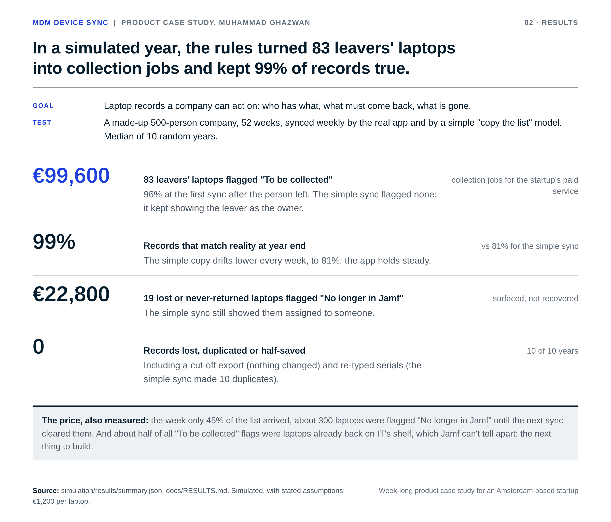

# Results

[Back to README](../README.md) · [All docs](../README.md#all-the-docs)

> **What this shows:** what the product achieves, not only that it works. Two tests after the build: a simulated year at a made-up company, run through the real app (this page, part 1), and AI test users with personas doing real tasks in the real app (part 2). Both are **simulated**: they use stated assumptions and made-up people, not real customers. Every number links to the file it comes from.

## Part 1: a year in the life of a 500-person company

**Goal:** laptop records a company can act on: who has which laptop, which ones must come back, which ones are gone.

**Question:** over a whole year of normal company life, does the product deliver that, compared with the obvious "just copy the list" approach?

**Test:** a made-up company of 500 people lives through 52 weeks. People leave (18% a year) and join, laptops come back or don't, get lost, get replaced after 4 years, move to a colleague, and Jamf's data is sometimes messy. Every week the real app syncs that week's Jamf list through its own API, unchanged. A model of the simple sync gets the same list. The simulation knows the truth, so both are scored on every laptop, every week. Ten different random years; the numbers below are the median, with the range across the ten years. How it works, every assumption and how to re-run it: [simulation/README.md](../simulation/README.md).

### Headline numbers (500 people, median of 10 years)

| | The app | Simple sync | Range across 10 years (app) |
|---|---|---|---|
| **Leavers' laptops flagged "To be collected from …"** | **83** (€99,600 of hardware) | 0 | 73 to 99 |
| ...flagged at the first sync after the person left | 96% | 0% | 90% to 100% |
| ...flagged within a week | 99% | 0% | 98% to 100% |
| **Records that match reality at year end** | **99%** | 81% | 98% to 99.5% (simple: 79% to 82%) |
| Records that match reality, average week | 98.7% | 90.3% | |
| **Lost or never-returned laptops flagged "No longer in Jamf"** | **19** (€22,800) | 0, shown as still assigned | 15 to 22 |
| Leaver laptops that never came back, flagged while IT could still chase them | all 9 | 0 | all of them every year (3 to 12) |
| Retired laptops flagged "No longer in Jamf" | 96 | 0 | |
| Duplicate records at year end (a re-typed serial) | **0** | 10 | simple: 6 to 16 |
| Records lost or deleted | **0** | 0 | |
| The week the export arrived cut off | **nothing changed**, plain message | (assumed: nothing changed) | 10 of 10 years |

*Value: €1,200 per laptop, an assumption. "Flagged" means the app shows it to a person who can act; it doesn't mean the laptop was recovered.*

### What the numbers mean for the business

- **Collection is the product's revenue moment, and the app finds it.** At a 500-person company, about 83 laptops a year leave with people. The app turned each one into a named "To be collected from …" job, almost always within the week. That's the moment the startup's paid collection service is needed. The simple sync never shows it: the leaver stays listed as the owner.
- **The value grows with the customer.** At 2,000 people it was about 321 laptops (€385,200) a year; at 100 people, about 13 (€15,600). Same rules, same accuracy: 99% at year end at every size.
- **Lost hardware becomes visible.** About 19 laptops a year are lost, stolen or never returned. The app flags each one "No longer in Jamf", with the last owner's name; the simple sync keeps calling them assigned.
- **The simple approach gets worse every week; the app doesn't.** The gap isn't one big failure, it's quiet drift: a wrong owner here, a missing laptop there. After a year one record in five is wrong.

### What it cost (also measured)

- **A short list causes one bad week.** In week 36 only 45% of the list arrived. The app applied it, as decided (call 4: an empty or short list is applied, because a sync never deletes). About 300 laptops were flagged "No longer in Jamf" for one week; the next good sync cleared them. (In two of the ten years one laptop stayed flagged a second week, because it really was missing from that week's list too.) Accuracy that week: 51%.
- **About half of the "To be collected" flags are already back.** A laptop on IT's shelf and a laptop still with a leaver look the same in Jamf: no owner. So the app keeps saying "To be collected" until IT re-issues or retires it. On average about 7 such flags a week at 500 people. Neither version can tell; it's a gap in what Jamf reports.
- **Retired laptops need a click each.** About 96 retired laptops a year stay "No longer in Jamf" until someone deletes them: the price accepted in call 2.

### What I'd change because of it

1. **A "Received by IT" button on "To be collected" laptops.** It answers the biggest remaining gap (half the flags) with one click, and it's also the first step of the collection order in [What I'd do next](WHAT-I-WOULD-DO-NEXT.md).
2. **A warning when the list is much shorter than last time**, before applying it, so the week-36 kind of drop gets a "this looks wrong" message instead of 300 flags. It's a softer version of an option I turned down in call 4 (refuse a list that looks suspicious); the simulation now shows the size of the problem (one week, about 300 flags, cleared automatically), which is useful when deciding whether to revisit it.
3. **Sync daily, not weekly.** Flags would show up within a day instead of within a week.

### Other sizes

| Company size | Years | Leaver laptops flagged a year | Records right at year end (app vs simple) | Average sync time |
|---|---|---|---|---|
| 100 people | 3 | 13 (€15,600) | 99.3% vs 81.3% | 0.1 s |
| 500 people | 10 | 83 (€99,600) | 98.8% vs 80.6% | 0.7 s |
| 2,000 people | 3 | 321 (€385,200) | 99.1% vs 80.6% | 2.6 s |

The slowest single sync was 30 seconds, in one of the 500-person years, when the laptop running the test was busy; the median sync in that year was under a second. The app's known limit (it breaks between 12,000 and 13,000 laptops, finding F15 in the [test log](TEST-LOG.md)) wasn't reached.

**Sources:** [simulation/results/summary.json](../simulation/results/summary.json) (all numbers), the per-year files in [simulation/results/](../simulation/results/), and the code in [simulation/](../simulation/).

### Limits

- Assumptions, not customer data. The rates are in [assumptions.json](../simulation/assumptions.json); change them and re-run.
- The simple sync is a model built from the weaknesses we found in the example approach, not anyone's real product.
- Nobody acts on the flags during the year, so costs (stale flags, retired laptops) are shown at their largest.
- The value figures count hardware that was flagged, not hardware recovered.

## Part 2: AI test users

*Coming next: AI testers with personas use the real app in a real browser and try three real tasks.*
