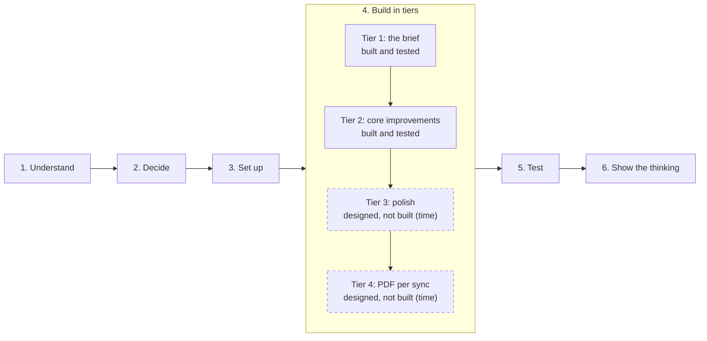

# What I would do next

[Back to README](../README.md) · [All docs](../README.md#all-the-docs)

How I'd take this further: business first, then making it a real product, then scale.

## Designed, not built

Tiers 1 and 2 are built and tested. Tiers 3 and 4 were planned and designed, but not built because of time. Each has its decision, my reasoning and its principles written down, so it can be built as designed. The details are in [DECISION-RECORDS.md](DECISION-RECORDS.md).

*The order of the work. Tiers 1 and 2 are built and tested; Tiers 3 and 4 (dashed) are designed, not built, because of time.*

| Feature | Decided in | Principles |
|---|---|---|
| Person page, with badges for laptops to collect or no longer in Jamf | Decision 6.3 | [P5][p5] [P17][p17] [P18][p18] |
| Home: what needs attention, and the last sync time (today: totals and Sync Now) | Decision 6.4 | [P5][p5] [P18][p18] |
| "Needs attention" button on the people list | Decision 6.1 | [P14][p14] [P18][p18] |
| Sync history page (the history itself is recorded today) | Quick approval 5 (a record of every sync), extended by me with the history page and PDF | [P4][p4] |
| "Hasn't checked in with Jamf for {n} days" warning | Decision 6.2c | [P4][p4] [P5][p5] |
| ⓘ on every field (today: on statuses that need a person and on "couldn't read") | Decision 6.2 | [P15][p15] [P17][p17] |
| Tier 4: a PDF of any sync | Sync history, my addition | [P2][p2] |

## Business

### Leaver detection into a collection order

"To be collected" already flags the moment a laptop loses its owner in Jamf. The next step is turning that flag into a collection order: scheduling, shipping labels and tracking. A company setting could choose between collecting from the person or from the office (my idea from decision 1).

### Replacement offers

Purchase date, battery health and model are already stored for every laptop. WorkWize could spot laptops that are old or worn out and offer a replacement before they fail.

### Jamf data health check

Claude Code's odd-data tests showed how small mistakes in a customer's Jamf cause wrong results without anyone noticing: a serial with a space, an email typo, numbers saved as text, an over-long name. WorkWize could turn these into a monthly report ("your MDM data has 3 issues") for the customer's IT team. It would also give WorkWize a regular reason to talk to them.

### Fleet reports

Counts by model, age, status and person, which finance and IT could export.

## Making it real

- **A live Jamf connection:** login, rate limits and paging. The count check is already written for a list that arrives in several pages.
- **Syncs on a schedule** (for example nightly), or when Jamf reports a change, not only from the Sync Now button.
- **Accounts and more than one company:** login, with each customer's data kept separate.

## Scale

These numbers were measured in testing ([TEST-LOG.md](TEST-LOG.md)).

- **Read the Jamf list page by page.** Today the whole file is loaded at once, so a sync breaks between 12,000 and 13,000 laptops (12,000 sync in about 7 seconds). A live Jamf connection sends the list in pages anyway. Kept as a limitation (F15).
- **Look up laptops and people in one go,** instead of one at a time. 5,000 laptops sync in about 3 seconds today, which is fine for a mid-size customer, but this is the next bottleneck.
- **Paging, search and filters in the lists.** 5,000 laptops load in about a second, but the page is about 380 screens long.
- **A short sync message at any size.** After a very large change, the message listed 6,871 laptops. Show the first 10, then "and 6,861 more" with a link to the filter. Kept as a limitation (F14).
- **Background syncs,** so a big sync doesn't keep the user waiting.
- **An alert when a sync fails or is interrupted.** Since fix F10, the history says "interrupted", but nobody is told.
- **Faster recovery after a crash.** Today the next sync can wait up to 5 minutes, with an honest message. A lock that knows its sync has died would let customers sync again straight away.
- **Thousands separators:** "4,897 unchanged" instead of "4897".

## Product

- **Preview what a sync would change** before applying it, when it looks unusual: "This sync would flag 5 of 7 laptops. Apply anyway?" Today an empty list caused by a Jamf hiccup is applied (decision 4). Nothing is deleted and the next good sync clears the flags, but a preview would avoid the false alarm.
- **"Hide" and "retired" that survive syncs,** instead of deletes that come back (see [PRODUCT-NOTES.md](PRODUCT-NOTES.md)).
- **Notifications** by email or Slack for items that need attention.
- **A separate "worth checking" list** for laptops that stopped checking in, kept apart from "Needs attention".
- **Writing changes back to Jamf,** for example reassigning a laptop from WorkWize. A question I'd like to ask the team first.

## More tools

- **Intune and Kandji:** one new translator each. The sync engine, the database and the website stay the same.
- **One combined view** of laptops from every tool.

## Trust

- **An audit log** of deletes and changes: who did what, and when.
- **How long to keep a leaver's details** (GDPR). WorkWize already removes values that Jamf removes.
- **Knowing who actually left,** through a connection to HR, since Jamf only reports devices.

[p2]: PRINCIPLES.md#p2-design-for-the-everyday-customer-make-the-worst-case-safe-and-fixable-dont-complicate-the-everyday-experience-for-rare-cases
[p4]: PRINCIPLES.md#p4-the-data-must-stay-honest-what-the-website-shows-must-match-reality
[p5]: PRINCIPLES.md#p5-a-status-should-lead-to-action
[p14]: PRINCIPLES.md#p14-things-clear-themselves-when-theyre-done
[p15]: PRINCIPLES.md#p15-context-everywhere-on-demand-the-info-symbol
[p17]: PRINCIPLES.md#p17-the-context-ladder-never-leave-something-blank-if-context-exists
[p18]: PRINCIPLES.md#p18-take-people-straight-to-the-problem-dont-make-them-search
