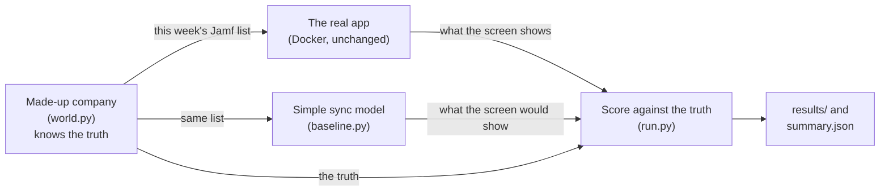

# Simulation: a year in the life of a 500-person company

[Back to README](../README.md) · [The results](../docs/RESULTS.md)

> **What this is:** a made-up company lives through 52 weeks. People join and leave, laptops come back, get lost, get replaced, and Jamf's data is sometimes messy or broken. Every week the real app syncs that week's Jamf list. A model of the simple "just copy the list" sync gets the same list. Because the simulation knows the truth about every laptop, both can be scored every week. **It is a simulation with stated assumptions, not data from real customers.**

## How it works



1. **[world.py](world.py)** builds the company (500 people, about 550 laptops, a few spares with IT) and moves it on one week at a time. It only hands out what Jamf would show: a list of laptops, each with an owner or none.
2. **The real app** runs exactly as shipped, in its own Docker project. Each week the list is written to a file the app reads, Sync Now is pressed through the app's own API, and the laptop list is read back. No app code was changed for the simulation.
3. **[baseline.py](baseline.py)** is the comparison: the obvious approach, in our own words, with the three weaknesses found in the review of the example approach (R2, R3 and R9 in [ENGINEERING.md](../docs/ENGINEERING.md#improvements-over-the-reference)). A laptop without an owner is skipped, so it keeps its old owner; a laptop missing from the list is left alone; serials are used exactly as sent. It never deletes either, so the comparison is only about what each version shows.
4. **[run.py](run.py)** scores every laptop every week: right (the screen matches the truth) or not, and why.
5. **[summarize.py](summarize.py)** turns the years into the numbers in [docs/RESULTS.md](../docs/RESULTS.md).

## What happens in a year

All rates are in **[assumptions.json](assumptions.json)**, in plain words. They are assumptions picked to be ordinary for a European tech company, not measured:

| Assumption | Value | Why this value |
|---|---|---|
| Staff who leave per year | 18% | Ordinary for a tech company (an assumption, not a measured figure) |
| Headcount growth per year | 5% | Modest growth |
| People with a second laptop | 8% | Engineers and designers with a test machine |
| A leaver's laptop comes back | 25% chance each week | Most come back within a month |
| Leaver laptops that never come back | 8% | Written off by IT after 12 weeks |
| Laptop age before it's replaced | over 4 years | A usual refresh cycle |
| Lost or stolen per year | 2% of laptops | IT removes them from Jamf |
| Handovers per year | 3% of laptops | A laptop moves to a colleague |
| A laptop drops out of Jamf for a week | 0.05% chance each week | A Jamf hiccup |
| A serial re-enrolled in another format | 2% per year | "C02 XK1", lower case, a leading space |
| Value per laptop | €1,200 | A typical work MacBook |

**Two stress weeks every year:** in week 20 the Jamf export arrives cut off half way (unreadable); in week 36 only 45% of the list arrives (readable, but short).

**What nobody does in the simulation:** nobody clicks anything in the app. Flags are never cleared by hand and nothing is deleted. That keeps both versions comparable, and it means the costs (flags someone has to clean up) show up in the numbers instead of being hidden.

## How a laptop is scored each week

| The truth | Right in the app when it shows | The simple sync shows |
|---|---|---|
| With an employee | Assigned to that employee | Assigned to that employee (right) |
| Owner left, laptop not back yet | To be collected from that person | Assigned to the person who left (wrong) |
| Lost, stolen, written off or retired | No longer in Jamf | Assigned to the last owner (wrong) |
| Back with IT, not yet re-issued | Never counted as right in either: Jamf shows "no owner" for both a leaver's laptop and one on IT's shelf, so neither version can know | |
| Missing from this week's list only (hiccup or short list) | Counted separately as a short-lived flag | |

## Run it yourself

From the repo root, with nothing else using ports 8000 and 3306:

```bash
mkdir -p backend/storage/app/simulation && cp files/api-mock-response.json backend/storage/app/simulation/jamf-this-week.json
MDM_JAMF_MOCK_PATH=/var/www/backend/storage/app/simulation/jamf-this-week.json docker compose -p mdm-portfolio-sim up -d --wait mysql backend
python3 simulation/run.py --seeds 1-10 --employees 500 --out simulation/results/500-employees
python3 simulation/summarize.py
docker compose -p mdm-portfolio-sim down -v
```

One simulated year takes about 40 seconds (53 syncs). Each "seed" is a different random year; the same seed always gives the same year. Python 3 only, no extra packages.

## Limits of this simulation

- **Assumptions, not data.** The rates are reasonable guesses. Change them in assumptions.json and re-run; the [results](../docs/RESULTS.md) show how they hold at 100 and 2,000 people.
- **The comparison is a model.** The simple sync is written from the weaknesses we found, not from anyone's real product.
- **One sync a week.** Syncing daily would make flags appear sooner.
- **Nobody acts on the flags.** In real life someone would collect the laptops and delete retired ones; here every flag stays until Jamf changes.
